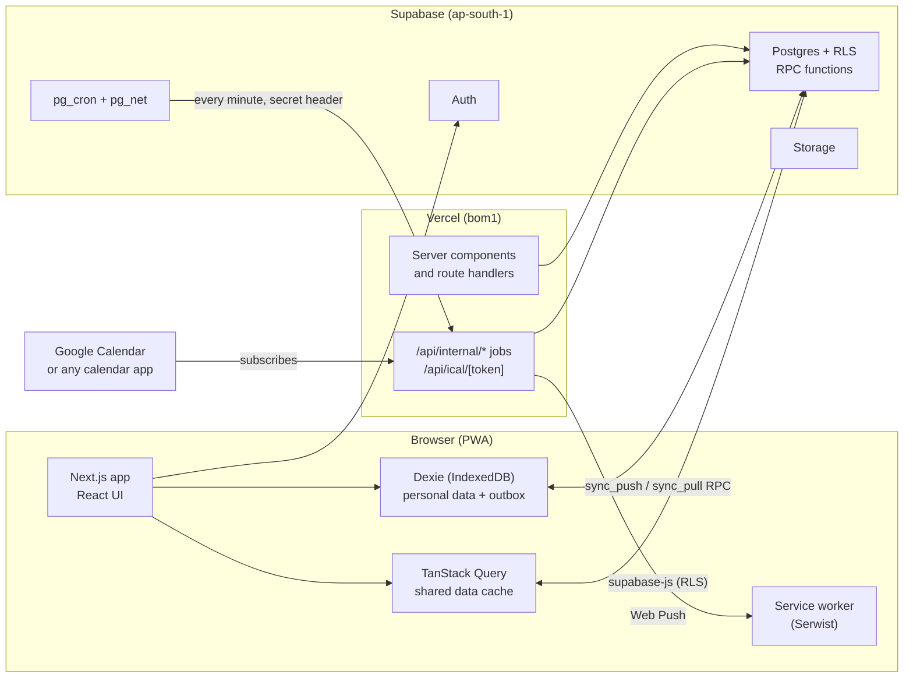

# Attendo Web: product and engineering specification

Version 1.0 · Owner: the product owner ("Owner") · Implementer: Claude ("Agent")

This document is the single source of truth for building Attendo Web. It is written so the Agent
can build the product stage by stage without guessing. Every requirement has an ID. Every stage has
entry conditions, tasks, deliverables and exit gates. Files referenced as `seed/...` ship next to
this document and must be copied into the repository unchanged.

---

## Contents

0. [How the Agent must work](#0-how-the-agent-must-work)
1. [Product overview](#1-product-overview)
2. [Locked decisions](#2-locked-decisions)
3. [Tech stack (all free)](#3-tech-stack-all-free)
4. [Architecture](#4-architecture)
5. [Domain rules and formulas](#5-domain-rules-and-formulas)
6. [Data model](#6-data-model)
7. [Roles and permissions](#7-roles-and-permissions)
8. [Feature specifications](#8-feature-specifications)
9. [Design system](#9-design-system)
10. [Public website and SEO](#10-public-website-and-seo)
11. [Security requirements](#11-security-requirements)
12. [Privacy and compliance](#12-privacy-and-compliance)
13. [Performance requirements](#13-performance-requirements)
14. [Quality engineering](#14-quality-engineering)
15. [Engineering process](#15-engineering-process)
16. [Operations: observability, incidents, backups](#16-operations-observability-incidents-backups)
17. [Error codes](#17-error-codes)
18. [Build stages](#18-build-stages)
19. [Owner inputs](#19-owner-inputs)
20. [Appendices](#20-appendices)

---

## 0. How the Agent must work

### 0.1 Order of authority

When two sources disagree, the higher one wins:

1. A written instruction from the Owner in the current conversation.
2. This specification.
3. Accepted ADRs in `docs/adr/`.
4. Existing code and comments.
5. The Agent's own judgement (only where 0.6 allows it).

### 0.2 Stage protocol (repeat for every stage in section 18)

1. Read the stage in section 18 and every section it references.
2. Enter plan mode and draft the stage plan: each task, the requirement IDs it covers, the files it
   touches and the tests that prove it.
3. Present the plan with ExitPlanMode and wait for the Owner's approval. Do not write code before
   that. The first commit of the stage saves the approved plan as `docs/stages/stage-NN-plan.md`.
4. Implement on short-lived branches (section 15.2), one pull request per task group.
5. Run every gate in section 15.5 locally before opening a pull request.
6. After merge, deploy to staging, run the stage's acceptance checklist, and record evidence
   (test reports, screenshots, Lighthouse JSON) in `docs/stages/stage-NN-evidence.md`.
7. Ask the Owner to run the user acceptance checklist (UAT) in the stage. On "accepted", release
   (section 15.7) and update `docs/stages/STATUS.md`.
8. Never start the next stage until the current stage's exit gates are all green and the Owner
   has accepted it.

### 0.3 Requirement IDs and traceability

- Requirement IDs look like `ATT-F-003` (area, type, number). Types: `F` functional, `N`
  non-functional, `S` security, `P` privacy, `U` UX. Every ID in this document has this shape
  (`AREA-T-NNN`); `*` in a stage scope (`GRP-F-*`) means every ID of that area and type.
- Every test name includes the IDs it proves, for example `test("ATT-F-003 undo restores the
  previous mark")`.
- `docs/traceability.md` maps every ID to its tests and to the stage that delivered it. A stage
  cannot close with an in-scope ID that has no test, unless the ID is marked "manual check" here.

### 0.4 Rules the Agent never breaks

1. Never commit secrets, keys, `.env` files or real user data. Use `.env.example` with empty
   values.
2. Never disable, skip or delete a test to make a build pass. Fix the cause.
3. Never bypass a gate in 15.5. Never merge with a red check.
4. Never use the Supabase service-role key in code that runs in the browser or in a request
   handled on behalf of a normal user. It is allowed only in `apps/web/src/server/internal/**`
   (the minute, daily and weekly jobs), each guarded as described in SEC-S-011. The console and the
   calendar feed don't use it: they call `SECURITY DEFINER` RPCs that check the caller themselves.
5. Never add a dependency that isn't in 3.3 without an ADR approved by the Owner.
6. Never write a database change except as a new migration file. Never edit an applied migration.
7. Never ship a user-facing string that contains an em dash, an emoji used as an icon, or a stack
   trace.
8. Never auto-mark attendance for a student. Attendance is always the student's own action.
9. Never send a notification without the user having opted in to that notification type.
10. Never log personal data (names, emails, messages, marks, attendance) to logs or Sentry.
11. Use TypeScript `strict`. No `any` and no `@ts-ignore` without a one-line reason comment and an
    issue link.
12. Keep `CLAUDE.md` (section 15.9) accurate: update its map in the same change that adds, moves or
    renames a folder or key file.

### 0.5 When to stop and ask the Owner

Stop and ask, with numbered options and a recommendation, before:

- anything that deletes or rewrites user data outside the specified flows;
- any change to roles, permissions or RLS policies beyond this spec;
- anything that costs money, needs a card, or changes a free-tier limit;
- legal text (privacy policy, terms) going live;
- any choice this spec says is the Owner's.

### 0.6 Defaults when this spec is silent

| Situation | Default |
|---|---|
| Copy wording not given | Plain, specific, sentence case, British spelling (en-IN), no em dashes (section 9.10) |
| Spacing or size not given | Nearest value on the scales in 9.4 and 9.5 |
| List longer than 50 items | Cursor pagination, 50 per page (PERF-N-009) |
| Date display | `EEE, d MMM` (Mon, 5 Aug); with year `d MMM yyyy`; times 12-hour `h:mm a` |
| Time zone | The user's institution time zone (Asia/Kolkata for NIT Trichy) |
| Week start | Monday |
| Empty list | The section's empty state (9.12) |
| Unknown error | `SYS-900` (section 17), report to Sentry, show the generic message |
| Animation not specified | None for frequent actions; 200 ms ease-out for entering, 150 ms ease-in for leaving |

---

## 1. Product overview

### 1.1 What Attendo is

Attendo is a free web app that helps college students stay on top of class attendance and the rest
of student life. Its core promise: a student always knows, in plain numbers, how many classes of
each subject they can still miss, or must attend, to stay at or above the minimum attendance
(75% per subject at NIT Trichy).

Around that core it offers:
- a timetable and the college's academic calendar;
- class groups where a class representative posts cancellations and changes;
- tasks (checklist, board, reminders);
- a focus timer;
- syllabus progress;
- grades with SGPA and CGPA;
- friends;
- insights;
- push reminders;
- calendar sync.

### 1.2 Who it's for

- Launch: one batch only, NIT Trichy MCA 2026-29. That's Semester I (July 2026 session), then
  Semester II (January 2027 session, from 4 Jan 2027); ACAD-F-002 moves students across. Other
  semesters, batches and programmes come later: a maintainer adds their terms and calendars, with
  no code changes.
- Later: students of any college. The data model is multi-institution from day one (ACAD-F-001);
  opening sign-ups to other colleges is a feature flag (`multi_institution`), off at launch.

### 1.3 Scope

In scope: everything in section 8.

Out of scope (do not build):
- the Android app or any sync with it;
- payments of any kind;
- official attendance records (Attendo is a personal tracker, not the college's system);
- chat or direct messages;
- AI features;
- languages other than English (but every string goes through the i18n layer, 4.7).

### 1.4 Glossary

| Term | Meaning |
|---|---|
| Institution | A college (NIT Trichy) |
| Programme | A degree programme at an institution (MCA) |
| Term | One semester's dates for a programme (July 2026 session, Semester I) |
| Session | An academic half-year with one official calendar ("2027-01" = January 2027 session). Several semesters' terms share a session (MCA II, IV and VI) |
| Course | A catalogue course of a programme (CA711) with credits, hours, syllabus |
| Subject | A student's own entry for a course they attend this term (may link to a course) |
| Mark | One attendance record: subject, date, status, sessions |
| Session | One lecture hour; a double class is one mark with 2 sessions |
| Held | Sessions that took place for a subject (present + absent; cancelled excluded) |
| Class group | The set of students in one class (programme + term + section), with reps and teachers |
| College pack | An institution's shared data: programmes, terms, courses, curriculum, calendar, grading |
| Staff | Users with a platform role (section 7) |

---

## 2. Locked decisions

These are final. Do not re-open them; record each as an ADR in Stage 0 (`docs/adr/0001-<slug>.md`
to `0023-<slug>.md`) using the template in 20.4.

| ADR | Decision |
|---|---|
| 0001 | Web app first. Mobile-first responsive design, installable as a PWA. |
| 0002 | All services on free tiers only. No paid plan, no card on file (section 3.4). |
| 0003 | Monorepo with pnpm workspaces and Turborepo. |
| 0004 | Next.js (App Router) with TypeScript, hosted on Vercel Hobby. |
| 0005 | Supabase (Postgres, Auth, Storage, pg_cron) as the backend; Row Level Security on every table. |
| 0006 | Sign-in with Google, or email and password (with email verification and password reset). |
| 0007 | Personal data is offline-first: written to IndexedDB, synced through the protocol in 4.4. |
| 0008 | Shared data (college packs, class groups, friends) is online, cached for offline reading. |
| 0009 | Multi-institution data model from the start; launch with NIT Trichy only. |
| 0010 | Web Push (VAPID) for notifications, sent from a Next.js route triggered every minute by Supabase pg_cron. |
| 0011 | Calendar sync is a one-way, per-user secret iCalendar feed (RFC 5545). |
| 0012 | New "bold and playful" visual identity (section 9); not the Android look. |
| 0013 | Motion modes "Apple" and "None", in a registry that accepts more modes later (9.8). |
| 0014 | Themes staged: Light and Dark first; five more themes, custom colours and a font picker later (Stage 9). |
| 0015 | Roles: student, class representative, teacher (institution-level); super admin, admin, moderator, maintainer, developer (platform-level). |
| 0016 | Attendance minimum 75% per subject at NIT Trichy, configurable per institution and per subject; no leave or on-duty types. |
| 0017 | Grades include SGPA and CGPA from credits and grade points. |
| 0018 | Every user-facing error carries a stable code (section 17). |
| 0019 | Trunk-based development, Conventional Commits, SemVer, Changesets. |
| 0020 | English only at launch, behind an i18n layer (next-intl). |
| 0021 | Pinned versions of every tool and package, and any build switch they need (3.1). |
| 0022 | No load balancer or server management: Vercel and Supabase handle scaling (13.3). |
| 0023 | Split content security policy: nonces on dynamic pages, a static policy on pre-rendered public pages (SEC-S-028). |

---

## 3. Tech stack (all free)

### 3.1 Version policy

- Node.js: the newest LTS major that Vercel offers in its project settings at Stage 0 (24.x is
  safe; use 26.x if Vercel lists it). Pin it in `.nvmrc`, `package.json` `engines` and the Vercel
  project setting.
- Next.js 16 specifics:
  - The request interceptor file is `apps/web/src/proxy.ts`. Next.js 16 renamed `middleware.ts` to `proxy.ts`.
  - `next build` uses Turbopack. If `@serwist/next` doesn't support Turbopack builds in the pinned version, build with `next build --webpack` and record it in ADR-0021.
- pnpm: latest 10.x, pinned with `packageManager` in the root `package.json`.
- For every package in 3.3:
  - At Stage 0, look up the latest stable version (`pnpm view <pkg> version`), and pin it exactly (no `^` or `~`).
  - Record the versions in ADR-0021 "Pinned versions".
  - If the latest stable major differs from the major in 3.3, use the table's major when it's still supported; otherwise use the newest major and note why in the ADR.
- Commit the lockfile. CI installs with `pnpm install --frozen-lockfile`.

### 3.2 Platform services

| Need | Service | Free tier used | Notes |
|---|---|---|---|
| Hosting, serverless functions, previews | Vercel Hobby | Free | Region `bom1` (Mumbai) for functions. Hobby is for personal, non-commercial projects; Attendo qualifies while it earns nothing |
| Database, auth, storage, scheduled jobs | Supabase Free | 2 projects: `attendo-staging`, `attendo-prod` | Region `ap-south-1` (Mumbai). Free projects pause after 7 days without activity: the keep-alive job in OPS-N-007 prevents that |
| Auth emails (verify, reset) | Gmail SMTP with an app password, as Supabase custom SMTP | Free, about 500 emails a day | A dedicated Gmail account owned by the Owner (19.2) |
| App emails (deletion confirmations, Owner alerts) | The same Gmail account, sent with `nodemailer` from server code | Free | Same daily limit, shared with auth emails |
| Error tracking | Sentry Developer | Free, 5,000 errors a month | No personal data (SEC-S-020) |
| Rate limiting | Upstash Redis | Free tier | Used by `@upstash/ratelimit` |
| Bot protection | Cloudflare Turnstile | Free | Sign-up, password reset, feedback, group join |
| Uptime | UptimeRobot | Free, 5-minute checks | Public status page |
| Web analytics | Vercel Web Analytics | Free Hobby allowance | Cookie-free; no personal data |
| Source control, CI | GitHub private repository, GitHub Actions | 2,000 Actions minutes a month (3,000 with GitHub Pro) | Branch protection on a private repository needs GitHub Pro, which is free with the GitHub Student Developer Pack (19.2). Keep CI lean (15.4) |
| Dependency updates | Dependabot | Free | Weekly, grouped |
| Domain | Vercel's free subdomain (`<project>.vercel.app`) | Free | `SITE_URL` is configuration. The Owner's list flags a bare `vercel.app` address as an AI giveaway, so Stage 10 moves to a custom domain if the Owner has a free one (for example the first-year domain in the GitHub Student Developer Pack). It's a config change only |

### 3.3 Libraries (approved list)

| Area | Package (major) |
|---|---|
| Framework | `next` (16), `react` and `react-dom` (19), `typescript` (5) |
| Styling | `tailwindcss` (4) with CSS variables from section 9 |
| Accessible primitives | `@radix-ui/react-*` (dialog, dropdown-menu, popover, tabs, toast, switch, tooltip, select, slider, radio-group, checkbox, scroll-area, visually-hidden) |
| Icons | `@phosphor-icons/react` (2), the only icon set |
| Motion | `motion` (12), Motion for React, always through `LazyMotion` with `domAnimation` and the `m.*` components, to keep the bundle small |
| Forms and validation | `react-hook-form` (7), `zod` (4), `@hookform/resolvers` |
| Server state | `@tanstack/react-query` (5) and `@tanstack/react-query-persist-client`, with a small IndexedDB persister written in `packages/sync` (no other persister package) |
| Local database | `dexie` (4), `dexie-react-hooks` |
| IDs | `uuid` (11) for v7 (new rows) and v5 (natural-key rows, 4.4.3) |
| Supabase | `@supabase/supabase-js` (2), `@supabase/ssr`, Supabase CLI (2) |
| Dates | `date-fns` (4), `@date-fns/tz` |
| Command menu | `cmdk` (1) |
| Toasts | `sonner` (2) |
| Charts | `recharts` (3) |
| PDF reports | `@react-pdf/renderer` (4) |
| CSV and zip | `papaparse` (5), `fflate` |
| Push | `web-push` (3), server only |
| Email | `nodemailer` (7), server only |
| PWA | `@serwist/next` (9), `serwist` |
| i18n | `next-intl` (4) |
| Rate limiting | `@upstash/ratelimit` (2), `@upstash/redis` |
| Monitoring | `@sentry/nextjs` |
| Testing | `vitest`, `@testing-library/react`, `@testing-library/user-event`, `@playwright/test`, `@axe-core/playwright`, `@lhci/cli`, `fake-indexeddb`, `ical.js` (feed parsing tests only), pgTAP via `supabase test db` |
| Quality | `eslint` (9, flat config), `typescript-eslint`, `eslint-plugin-boundaries`, `eslint-plugin-jsx-a11y`, `prettier` (3), `knip`, `@next/bundle-analyzer`, `husky`, `lint-staged`, `@commitlint/cli`, `@commitlint/config-conventional`, `@changesets/cli` |
| Design system docs | `storybook` (with `@storybook/nextjs`) |
| Build | `turbo` (2) |

Fonts (self-hosted with `next/font`; all under the SIL Open Font License or Apache 2.0, so free to
bundle): Bricolage Grotesque (display).
Later, for the font picker (Stage 9): Roboto, Open Sans, Montserrat, Lato, Poppins, Plus Jakarta
Sans, Courier Prime, Caveat.

### 3.4 Running cost

₹0 a month. Every service above is used within its free tier. If a free limit is approached, the
alerts in OPS-N-006 fire, and the Agent stops and asks the Owner (0.5). The Owner must never be asked
for card details.

---

## 4. Architecture

### 4.1 System overview



### 4.2 Repository layout

```text
attendo-web/
  apps/
    web/                      Next.js app: public site, app, console, API routes
      src/
        app/                  Routes (section 4.3)
        features/             One folder per feature module (4.5)
        server/               Server-only code: auth helpers, internal jobs, ical, push
        lib/                  App-wide helpers (env, logger, errors, i18n)
        sw/                   Service worker source
      messages/en.json        All user-facing strings
      public/                 Static assets (icons, OG images, robots, llms.txt)
  packages/
    core/                     Pure TypeScript domain logic (section 5). No React, no I/O.
    db/                       Generated database types, query helpers, Zod schemas per table
    sync/                     Offline engine: Dexie schema, outbox, push/pull, conflict rules
    ui/                       Design system components and tokens (section 9), Storybook
    config/                   Shared ESLint, TypeScript and Tailwind presets
  supabase/
    migrations/               SQL migrations (timestamped), forward-only
    seed/                     Seed SQL generated from seed/*.csv
    tests/                    pgTAP tests for RLS and RPC functions
    functions/                (unused in v1; reserved)
  scripts/                    seed-from-csv.ts, seed-test-users.ts and other one-off scripts
  tools/semgrep/              Custom Semgrep rules (15.5)
  seed/                       CSV files shipped with this spec (copied unchanged)
  docs/                       Architecture, ADRs, stages, runbooks, error codes, privacy, security
  .github/                    Workflows, PR template, CODEOWNERS, Dependabot
  CLAUDE.md                   Agent map and rules (15.9)
```

### 4.3 Routes

| Path | What | Rendering | Auth |
|---|---|---|---|
| `/` | Landing page | Static | Public |
| `/about`, `/privacy`, `/terms`, `/help`, `/changelog` | Public pages | Static | Public |
| `/help/errors/[code]` | One error code explained | Static (generated from 17) | Public |
| `/sign-in`, `/sign-up`, `/forgot-password`, `/reset-password`, `/verify-email` | Auth screens | Dynamic | Signed out |
| `/auth/callback` | OAuth and email link callback | Route handler | Any |
| `/welcome` | "Before you start": age confirmation and terms for Google sign-ups (AUTH-F-002) | Client | Signed in, no consent recorded |
| `/offline` | Offline fallback page (4.8) | Static | Public |
| `/onboarding` | First-run setup | Client | Signed in, not onboarded |
| `/app` | Home | Client (app shell) | Signed in, onboarded |
| `/app/classes`, `/app/classes/[subjectId]` | Attendance and subject page | Client | Same |
| `/app/timetable`, `/app/calendar` | Timetable and calendar | Client | Same |
| `/app/tasks` (`?tab=checklist|board|reminders`) | Tasks | Client | Same |
| `/app/focus` (`?tab=timer|syllabus|stats`) | Focus | Client | Same |
| `/app/stats` (`?tab=attendance|insights|grades`) | Statistics | Client | Same |
| `/app/groups`, `/app/groups/[groupId]` | Class groups | Client | Same |
| `/app/groups/join` (`?code=`) | Join a class group by code | Client | Same |
| `/app/friends`, `/app/friends/[userId]` | Friends | Client | Same |
| `/app/notifications` | Notification centre | Client | Same |
| `/app/settings/*` | Settings (profile, appearance, notifications, calendar sync, data, account, feedback) | Client | Same |
| `/console/*` | Staff console (section 8.16) | Dynamic | Platform role + MFA |
| `/api/ical/[file]` | Calendar feed. `file` is `<token>.ics`: strip the suffix in the handler, because a dynamic segment can't carry a fixed suffix | Route handler | Token |
| `/api/internal/tick` | Minute job (notifications) | Route handler | `CRON_SECRET` |
| `/api/internal/daily` | Daily job at 03:00 IST (account purges, group archiving, retention clean-ups) | Route handler | `CRON_SECRET` |
| `/api/internal/weekly` | Weekly job, Monday 06:00 IST (free-tier usage, OPS-N-006) | Route handler | `CRON_SECRET` |
| `/api/health` | Health check | Route handler | Public, no data |
| Anything else | 404 page | Static | Public |

The proxy (`apps/web/src/proxy.ts`):
- refreshes the Supabase session;
- sets the CSP nonce for dynamic pages (SEC-S-028);
- redirects signed-out users from `/app` and `/console` to `/sign-in?next=...`. `next` must be a
  relative path that starts with a single `/`, otherwise it's ignored (no open redirects);
- redirects signed-in users without `age_confirmed_at` to `/welcome`, then users who aren't
  onboarded to `/onboarding`;
- blocks `/console` without a platform role (SEC-S-005).

The proxy is a convenience: every server action and RPC re-checks permissions (SEC-S-004).

### 4.4 Offline-first sync (personal data)

#### 4.4.1 What is synced

Personal tables (section 6.4), all scoped to `user_id = auth.uid()`:
- `subjects`
- `attendance_marks`
- `timetable_slots` (personal)
- `personal_events`
- `assessments`
- `course_results`
- `focus_sessions`
- `habits`, `habit_checkins`
- `board_columns`, `board_cards`
- `reminders`
- `syllabus_progress`
- `user_preferences`

#### 4.4.2 Row shape

Every synced row has:
- `id uuid`;
- `user_id uuid`;
- `client_updated_at timestamptz`, set by the device on every change;
- `updated_at timestamptz`, set by the server;
- `sync_seq bigint`, set by the server from the global sequence `sync_seq_global`;
- `deleted_at timestamptz null`: a soft delete, so deletions sync.

#### 4.4.3 IDs

- New rows use UUID v7, generated on the device.
- Rows with a natural key use UUID v5, computed from that key, so two offline devices create the same ID:
  - `attendance_marks`: `v5(ns, user_id + "|" + subject_id + "|" + date)`
  - `habit_checkins`: `v5(ns, habit_id + "|" + date)`
  - `syllabus_progress`: `v5(ns, user_id + "|" + course_unit_id)`
  - `user_preferences`: `id = user_id`

  The namespace `ns` is the constant `6f9619ff-8b86-4d11-b42d-00c04fc964ff`, kept in `packages/core/ids.ts`.
- Clearing a mark soft-deletes its row. Marking that day again upserts the same row (same v5 ID)
  with `deleted_at = null`.

#### 4.4.4 Local write

1. Validate with the table's Zod schema.
2. Write the row to Dexie with `client_updated_at = now()`.
3. Append an outbox entry `{ opId: uuidv7(), table, rowId, op: "upsert" | "delete", row, createdAt, attempts: 0 }`.
4. Update the UI from Dexie straight away (optimistic).
5. Schedule a push 2 seconds later (debounced).

#### 4.4.5 Push

1. Take up to 100 outbox entries, oldest first.
2. Call the RPC `sync_push(ops jsonb)`. It refuses calls with more than 100 ops and runs in one
   transaction.
   - Its first statement is `perform pg_advisory_xact_lock(hashtextextended(auth.uid()::text, 0))`.
     This serialises one user's pushes, so their `sync_seq` values become visible in order.
     Without it, a pull could skip a row whose transaction committed late.
   - Personal tables have no write policies (6.7), so this RPC is the only way to change them.

   Then, for each op, it:
   - skips ops whose `opId` is already in `sync_applied_ops`, which makes push idempotent;
   - clamps `client_updated_at` to `now()` when it's more than 5 minutes in the future, so a
     device with a wrong clock can't win every conflict;
   - checks `row.user_id = auth.uid()`; otherwise rejects with `SYNC-203`;
   - applies the upsert or soft delete only if `incoming.client_updated_at >= stored.client_updated_at`
     (last writer wins). A stale op is reported as `"stale"`; it isn't an error;
   - inserts the `opId` into `sync_applied_ops`.
3. The RPC returns `{ opId, status: "applied" | "stale" | "rejected", code? }[]`.
4. The client removes applied and stale entries from the outbox.
5. On a rejected entry, the client:
   - keeps it, increments `attempts` and records the code;
   - after 5 attempts, moves it to `outbox_dead` and shows a sync problem banner with code `SYNC-204` and a "Retry" action.

#### 4.4.6 Pull

1. Call `sync_pull(since_seq bigint, limit int = 500)`.
2. It returns rows from all personal tables with `sync_seq > since_seq` for `auth.uid()`, ordered by `sync_seq`, deleted rows included, plus `max_seq`.
3. The client upserts each row into Dexie, unless the row has a pending outbox entry with a newer `client_updated_at`, in which case the local version wins until it's pushed.
4. Store `max_seq` as the cursor. Repeat while the page is full.

#### 4.4.7 When sync runs

- After sign-in: a full pull from 0.
- On app start, on window focus, and on the `online` event.
- Every 60 seconds while the tab is visible.
- 2 seconds after a local write.
- In the service worker's Background Sync event `attendo-sync`, where supported.

#### 4.4.8 Status in the UI

A small status chip in the app header:
- "Saved": nothing pending;
- "Saving…": push in flight;
- "Offline, changes saved on this device": offline with pending entries;
- "Sync problem (SYNC-204)": dead entries.

The chip is for information only and never blocks the UI.

#### 4.4.9 Sign-out

Before signing out, attempt a final push.
- If entries are still pending, warn "You have changes that haven't synced yet. Sign out anyway?" (SYNC-205).
- On sign-out, clear Dexie and the query cache for that user.

#### 4.4.10 Tests

- Unit tests in `packages/sync` with `fake-indexeddb`.
- pgTAP tests for `sync_push` and `sync_pull`:
  - idempotency;
  - last writer wins;
  - cross-user rejection;
  - soft deletes;
  - cursor paging.
- Playwright offline test: go offline, mark attendance, reload, go online, and check the server has the mark.

### 4.5 Feature module boundaries

Each folder in `apps/web/src/features/<module>/` holds:
- `components/`
- `hooks/`
- `server/` (server actions)
- `queries.ts`
- `schemas.ts`
- `index.ts` (the only public entry)

Rules, enforced by `eslint-plugin-boundaries`:
- Features may import from `packages/*` and from other features' `index.ts` only.
- `packages/core` imports nothing from the app or other packages, except `zod` and `date-fns`.
- `packages/ui` imports nothing from features.
- Route files in `app/` compose features. They contain no business logic.

Modules:
- `auth`, `onboarding`, `academics` (college packs), `attendance`, `timetable`, `calendar`
- `groups`, `notifications`, `tasks`, `focus`, `syllabus`, `grades`, `insights`, `friends`
- `settings`, `data` (export, import, deletion), `feedback`, `console`, `public-site`

### 4.6 Data access rules

- Browser code talks to Postgres only through `supabase-js` with the user's session. RLS enforces
  access.
- Multi-step writes, and any write that touches another user's rows (friend requests, group
  posts), go through Postgres functions (RPC) with `SECURITY DEFINER`. Each one:
  - checks permissions explicitly at the top;
  - uses `SET search_path = public`;
  - is covered by pgTAP tests.
- Server components read with the user's session (`@supabase/ssr`). Only `server/internal/**` uses
  the service role.
- Every input crossing a trust boundary (form, RPC argument, route parameter, import file) is
  validated with Zod on the client and again with Zod (server actions) or SQL checks (RPC) on the
  server.

### 4.7 Internationalisation

- All strings live in `apps/web/messages/en.json`, keyed by feature: `attendance.mark.present`.
- Numbers, dates and percentages are formatted with `Intl` in locale `en-IN`. Lists of numbers use
  tabular figures (9.3).
- No string concatenation for sentences. Use ICU messages with placeholders and plural rules.

### 4.8 PWA and caching (service worker)

- **What it caches:**
  - Serwist precaches the build's static assets (JS, CSS, fonts, icons) and `/offline`.
  - Navigations under `/app`: network first with a 3-second timeout, then the cached copy of that page from the last online visit, then `/offline`. Personal data comes from IndexedDB, so a cached app page works fully offline.
  - Public pages: stale-while-revalidate.
- **Never cached:** `/api/*`, `/auth/*`, `/console/*` and every Supabase request. TanStack Query and Dexie handle data.
- **Updates:** when a new service worker is waiting, show the toast "A new version is ready · Reload". Never reload by itself.
- **Manifest:** `display: standalone`, `start_url: /app`, `scope: /`, theme colours from 9.2.
- **Background Sync:** the tag `attendo-sync` (4.4.7) where the browser supports it; otherwise sync runs on the next open.

---

## 5. Domain rules and formulas

All of section 5 lives in `packages/core` as pure functions. Each subsection lists test vectors that
must appear as unit tests, verbatim. Floating-point comparisons use `EPSILON = 1e-9`.

### 5.1 Attendance (ATT)

Inputs per subject:
- marks `{ date, status: present | absent | cancelled, sessions: 1 | 2 }` (2 = double class;
  cancelled marks store 1 and don't count);
- `targetPercent` (integer 1 to 100; default from the institution, 75);
- `lectureHours` (nullable).

| Name | Definition |
|---|---|
| present | Σ sessions of marks with status present |
| absent | Σ sessions of marks with status absent |
| held | present + absent (cancelled sessions are not held) |
| percent | held = 0 → 0; else present × 100 / held |
| isOnTrack | held = 0, or percent + EPSILON ≥ targetPercent |
| classesCanSkip | t = target/100. t ≤ 0 → unlimited. Else max(0, floor(present / t − held + EPSILON)) |
| classesNeeded | t = target/100. t ≤ 0 or isOnTrack → 0. t ≥ 1 → unreachable. Else max(0, ceil((t × held − present) / (1 − t) − EPSILON)) |
| lecturesLeft | lectureHours null → null; else max(0, lectureHours − held) |
| courseSkipsLeft | null if lecturesLeft null. total = held + lecturesLeft; mustAttend = ceil(t × total − EPSILON); stillToAttend = max(0, mustAttend − present); result = lecturesLeft − stillToAttend (negative means the target can't be reached any more) |
| bestFinalPercent | null if lecturesLeft null or total = 0; else (present + lecturesLeft) × 100 / total |
| overallPercent | Σ present over all active (not archived) subjects × 100 / Σ held; 0 when Σ held = 0 |

Display rules:
- **Percent:**
  - Shown to whole numbers in lists and one decimal on the subject page.
  - On track: rounded half-up at that precision.
  - Below target: rounded down at that precision, so a value under the target never displays as
    the target.
  - Examples at a 75% target:

    | Value | In lists | On the subject page |
    |---|---|---|
    | 74.6 | "74%" | "74.6%" |
    | 74.96 | "74%" | "74.9%" |
    | 85.25 | "85%" | "85.3%" |
- **Status line:**
  - On track: "Can miss N" (N = classesCanSkip). If N = 0: "Don't miss the next class".
  - Below target: "Attend the next N".
  - Unreachable: "Target can't be reached".
- **Outlook (subject page, when lectureHours is set):**
  - courseSkipsLeft ≥ 0: "You can miss N of the X lectures left".
  - courseSkipsLeft < 0: "Even attending all X lectures left ends at Y%".

Test vectors (target 75 unless stated):

| present | absent | Expected |
|---|---|---|
| 34 | 6 | percent 85.0, isOnTrack true, canSkip 5, needed 0 |
| 28 | 12 | percent 70.0, isOnTrack false, canSkip 0, needed 8 |
| 30 | 10 | percent 75.0, isOnTrack true, canSkip 0, needed 0 |
| 0 | 0 | percent 0, isOnTrack true, canSkip 0, needed 0 |
| 3 | 1 (target 100) | needed unreachable |
| 5 | 5 (target 0) | canSkip unlimited, needed 0 |
| 15 | 5, lectureHours 40 | lecturesLeft 20, courseSkipsLeft 5, bestFinalPercent 87.5 |
| 10 | 10, lectureHours 30 | lecturesLeft 10, mustAttend 23, courseSkipsLeft −3, bestFinalPercent 66.67 |

Double class: one mark with sessions 2 and status present adds 2 to present and 2 to held.

Marking rules:
- **ATT-F-010:** tapping the active status again clears the mark (soft delete).
- **ATT-F-011:** ×2 toggles sessions between 1 and 2. It only applies to present or absent; it's disabled for cancelled or no mark.
- **ATT-F-012:** marks can be set for any date from term start to today. Future dates are read-only, with the hint "You can mark this day when it comes".

### 5.2 Subject short names (ACAD)

`shortName(subject)`:
1. If the linked course has `short_name`, use it.
2. Otherwise split the name on spaces and hyphens, dropping empty parts:
   - one word: return its first 8 characters (no " Lab" suffix);
   - several words:
     1. Drop the stop words `and, of, using, for, the, in, to, with` and the word `lab` (all case-insensitive).
     2. Take the first letter of each remaining word, in upper case, and keep at most 5.
     3. Append " Lab" when the subject is a lab.

`isLab`: the course type is lab, or the name contains the word "lab" (case-insensitive).

Tests:
- "Problem Solving and Programming" with no short name → "PSP".
- "Operating Systems Lab" → "OS Lab".
- "Compilers" → "Compiler".

### 5.3 Nickname (SET)

`nickname(name)`:
- Trim the name.
- If it's 10 characters or fewer, return it.
- Otherwise take the first 4 letters, skipping anything that isn't a letter (if there are no
  letters, take the first 4 characters). Lowercase them and capitalise the first.

Tests:
- "Alexandra Fernandes" → "Alex"
- "Ten Chars!" → "Ten Chars!"
- "Al Pacino Junior" → "Alpa"
- "12345678901" → "1234"

### 5.4 Timetable (TT)

- **Slot:** `{ weekday 1..7 (ISO, Monday = 1), startsAt, endsAt, subjectId, room }`; `startsAt < endsAt`.
- **on(date):** slots with the date's weekday, sorted by startsAt, then endsAt.
- **next(now):** the first slot today with `now < endsAt`, which may be in progress.
- **overlaps(a, b):** same weekday, and `a.start < b.end` and `b.start < a.end`.
  - Saving an overlapping slot is allowed, with a warning: "Overlaps with DSA 10:00 to 11:00".
- **Effective timetable for a date:**
  1. Start from the student's personal slots.
  2. If the student follows a class group timetable (GRP-F-020), use the group's slots, then apply that group's changes for the date (5.9). Personal slots for the same subject and time override the group slot.

### 5.5 Academic calendar (CAL)

- **Event:** `{ startsOn, endsOn ≥ startsOn, kind, title, source }`.
  - Kinds: `classes_start`, `classes_end`, `holiday`, `exam`, `deadline`, `event`.
  - Sources: `official`, `class_group`, `personal`.
- **Weekend:** the institution's `weekend_days` (NIT Trichy: Saturday and Sunday).
- **isHoliday(d):** a weekend day, or any holiday event covers d.
- **isClassDay(d):**
  - If the term's session has a classes_start and a classes_end: d is between them (inclusive) and not a holiday.
  - Otherwise: not a holiday.
  - College fests are holidays in the seed (classes don't run on their weekdays).
  - Test vectors, from the seed calendars; each matches the working-day count printed in the official calendar:
    - July 2026 session: 68 class days from 13 Aug to 25 Nov 2026.
    - January 2027 session: 70 class days from 4 Jan to 21 Apr 2027.
- **Events a student sees:** the institution's published events where:
  - `programme_id` is null or theirs;
  - `session` is null or their current term's session;
  - `semesters` is null or contains their term's semester.
- **Day strip range:** from min(classesStart, today − 7) to max(semesterEnd, today + 7), where semesterEnd is the last exam's end, or else classes_end.
- **Mascot line for a date (Home and Classes):**
  - Take the highest-priority event covering the date: holiday > exam > classes_start / classes_end > event > deadline.
  - If there is none, use the weekend line, then the next event within 3 days.
  - Copy, where `{t}` is the event title and `{n}` the day count:

| Case | Line |
|---|---|
| classes_start | "Classes start today. New semester, fresh streak." |
| classes_end | "Last day of classes. Check every subject before the attendance list goes up." |
| holiday | "{t}. No classes today." |
| exam | "{t}{ (day x of y)}. Deep breath, you've got this." |
| deadline | "Reminder: {t lowercased first letter}." |
| event | "{t}{ (day x of y)}. Have fun, and keep an eye on attendance." |
| weekend | "It's the weekend. No classes today." |
| upcoming | "Heads up: {t} {tomorrow / in n days}." |

### 5.6 Grades (GRD)

**Assessment:**
- Fields: `{ title, scored ≥ 0, maxMarks > 0 and ≤ 1000, assessedOn?, weightPercent? }`.
- percent = clamp(scored / maxMarks × 100, 0, 100).
- Suggested titles, offered as one-tap chips: "1st Assessment", "2nd Assessment", "Compensation", "Assignment", "Lab exam", "End semester".

**Subject marks:**
- With no weights: percent = Σ scored / Σ maxMarks × 100.
- If every assessment has a weight: percent = Σ (assessment percent × weight) / Σ weight.
- With mixed weights, show the error `GRD-701` "Give every assessment a weight, or none".

**Grading mode** comes from the institution's grading scheme (`grading_schemes.mode`):
- `relative` (NIT Trichy):
  - Letters are awarded relative to the whole class's marks, so a percent can't predict a letter.
  - The subject's percent is shown with the note "NIT Trichy grades relatively, so your letter depends on how the whole class does."
  - No expected letter is ever shown.
- `absolute` (for other institutions later): the expected letter is the highest letter whose `min_percent` ≤ percent, always labelled "Expected (guide)".

**Grade points (NIT Trichy, `seed/nitt_grading_scheme.csv`):** S 10, A 9, B 8, C 7, D 6, E 5, F 0 (fail).

**What-if SGPA (GRD-F-002):**
- Before results come out, the student can pick a hoped-for letter for each course of the term and see the SGPA those letters would give.
- Picks aren't saved.
- The panel is titled "What if", so it can't be mistaken for a result.

**Course result:**
- Fields: `{ termId, subjectId or courseId, letter, gradePoints, credits }`.
- The student enters the final letter when results come out; grade points come from the scheme.

**SGPA(term)** = Σ(credits × gradePoints) / Σ credits over that term's results.
- Courses without credits are excluded, and the screen shows "Credits missing for: CA701".
- No results: show "No results yet".

**CGPA** = the same sum over all terms' results.

**Display:** SGPA and CGPA to 2 decimals (half-up). Inputs keep full precision.

Tests:
- Credits 4, 4, 3 with points 10, 8, 9 → SGPA = (40 + 32 + 27) / 11 = 9.00.
- Credits 3 (S), 3 (A), 2 (F) → (30 + 27 + 0) / 8 = 7.125, shown as 7.13.
- NIT Trichy MCA Semester I (CA711, CA713, CA715, CA717, CA719, CA701, CA703):
  - credits 3, 4, 3, 3, 4, 2, 2;
  - letters A, S, B, A, S, S, A;
  - → (27 + 40 + 24 + 27 + 40 + 20 + 18) / 21 = 196 / 21 = 9.333…, shown as 9.33.
- Relative mode: the expected letter is null for every percent.
- No results → null.

### 5.7 Focus timer (FOC)

**Defaults:** focus 25 minutes, short break 5, long break 15, a long break after every 4 completed
focus sessions.

**Settings ranges:**
- focus 5 to 90;
- short break 1 to 30;
- long break 5 to 60;
- long break every 2 to 8.

**Timer state:**
- `{ kind, plannedSeconds, startedAt, pausedRemaining?, completedFocusCount }`.
- It's persisted in Dexie, so a reload or a closed tab resumes correctly.
- Remaining time is computed from wall-clock time, never by counting ticks.

**Clock text:** mm:ss, rounded up to the whole second (25:00 at the start, never 24:59).

**Session record:**
- Fields: `{ date, startedAt, kind, subjectId?, plannedSeconds, actualSeconds, completed }`.
- completed = the timer reached zero.
- Reset or skip saves a record with completed false, but only if actualSeconds ≥ 60.

**Summary:**
- todayMinutes, weekMinutes (the last 7 days including today), totalMinutes and completedFocusSessions.
- streakDays: consecutive days with at least one completed focus session, ending today, or yesterday if none yet today.
- last7Days: oldest first.
- bySubject: minutes per subject, "General" when there's no subject, largest first, zeros dropped.

Minutes are the integer division of the seconds by 60.

### 5.8 Tasks (TSK)

**Habit (checklist):**
- Fields: `{ title ≤ 80, weekdays: set of 1..7 (non-empty), position }`. A habit is due on a date when the date's weekday is in the set.
- **Streak:**
  - Count back from today the scheduled days that were ticked.
  - An unticked today doesn't break the streak; a missed earlier scheduled day ends it.
  - Days before the habit's creation date don't count against it.
  - Look back at most 730 days.

Tests:
- A Mon/Wed/Fri habit created three weeks ago, ticked only on Mon, Wed and Fri of last week and
  Mon this week; today is Tue → streak 4.
- Same habit, but last Wednesday unticked → streak 2.

**Board:**
- A new board has the columns "To do", "Doing" and "Done"; the last one is marked done.
- Cards have `{ title ≤ 120, notes ≤ 2000, dueOn?, priority: none | low | medium | high, position }`.
- Move rules (from the Android app):
  - moving a card renumbers positions 0..n in the source and target columns;
  - an index is clamped to the column's bounds;
  - overdue = has a due date, the date is before today, and the card isn't in a done column;
  - "Next" moves the card to the next column to the right.

**Reminder:**
- Fields: `{ title ≤ 120, dueOn, remindAt time?, doneAt? }`.
- Agenda groups:
  - Overdue: open, dueOn before today.
  - Today: all of today's, open first, then done.
  - Upcoming: open, after today.
  - Done: done and not today, newest first.
- Within a group, sort by dueOn, then remindAt (no time comes last), then created time.

### 5.9 Class group changes (GRP)

A change applies to one date:
- `{ kind: cancelled | room_change | time_change | extra_class, slotId?, courseId, newStartsAt?, newEndsAt?, newRoom?, note ≤ 200 }`.
  - cancelled: the slot isn't held that day.
  - room_change: replaces the room.
  - time_change: replaces the times.
  - extra_class: adds a one-off slot.
- The effective day view shows each change with a label: "Cancelled", "Room changed to B201", "Moved to 2:00 PM", "Extra class".
- **GRP-F-031:** a cancelled class shows the prompt "Cancelled by your class rep. Mark as no class?" with one-tap confirmation. It is never applied automatically (0.4 rule 8).

### 5.10 Insights (INS)

- **Weekly trend:** for each subject, the cumulative percent at the end of each ISO week from the term start to today.
- **Projection (shown only when the subject has at least 5 held sessions):**
  - Expected remaining sessions:
    - lectureHours set: lecturesLeft;
    - else: the count of the subject's timetable slots on class days from tomorrow to classes_end;
    - neither: hide the projection.
  - Current rate r = present / held.
  - Projected final percent = (present + r × remaining) / (held + remaining) × 100.
  - Text: "At your current rate you'll finish at Y%". Add "(below 75%)" when Y < target.
- **Risk list:** subjects whose projection or current percent is below target, sorted by classesNeeded, descending.
- **Report (PDF):**
  - Student name and institution, term, generation date.
  - A table per subject: present, absent, held, percent, target, status line.
  - Overall percent.
  - The footer "Self-recorded with Attendo. Not an official record."

---

## 6. Data model

All tables live in `public` with RLS enabled (SEC-S-003). Types are Postgres. Every table has
`created_at timestamptz not null default now()`. "Synced" tables also have the columns in 4.4.2.
Text limits are enforced with `check (char_length(col) <= N)`.

### 6.0 Enums (Postgres enum types, created in the Stage 0 base migration)

| Enum | Values |
|---|---|
| `platform_role` | super_admin, admin, moderator, maintainer, developer |
| `group_role` | student, class_rep, teacher |
| `mark_status` | present, absent, cancelled |
| `calendar_kind` | classes_start, classes_end, holiday, exam, deadline, event |
| `change_kind` | cancelled, room_change, time_change, extra_class |
| `focus_kind` | focus, short_break, long_break |
| `card_priority` | none, low, medium, high |

### 6.1 Identity

| Table | Columns | Notes |
|---|---|---|
| `profiles` | `id uuid pk references auth.users on delete cascade`, `display_name text ≤ 60 not null`, `avatar_url text`, `institution_id uuid fk`, `programme_id uuid fk`, `current_term_id uuid fk null`, `friend_code text unique not null` (6 chars, A-Z and 2-9, no 0/O/1/I), `share_attendance_with_friends bool default true`, `share_grades_with_friends bool default false`, `share_with_teachers bool default false`, `onboarded_at timestamptz`, `age_confirmed_at timestamptz null`, `terms_version text null`, `is_teacher_verified bool default false`, `deletion_requested_at timestamptz`, `suspended_until timestamptz`, `updated_at` | Created by a trigger on `auth.users` insert that must never fail. display_name comes from sign-up metadata (`display_name`), else Google's `full_name`, else the part of the email before `@`. The consent fields come from metadata for email sign-ups and stay null for Google sign-ups until `/welcome` (AUTH-F-002). friend_code is random and retried on collision. Users can update only display_name, avatar_url and the share_* columns (column-level `GRANT UPDATE`); everything else changes through RPCs |
| `platform_roles` | `user_id uuid fk`, `role platform_role`, `granted_by uuid`, `granted_at` | pk (user_id, role). Enum: super_admin, admin, moderator, maintainer, developer |
| `user_preferences` (synced) | `id = user_id`, `theme text default 'light'`, `font text default 'system'`, `motion_mode text default 'apple'`, `notification_prefs jsonb` (6.6), `focus_settings jsonb`, `home_layout jsonb` | |

### 6.2 Academics (college packs)

| Table | Columns |
|---|---|
| `institutions` | `id`, `slug text unique`, `name`, `short_name`, `city`, `state`, `country char(2)`, `timezone text`, `weekend_days smallint[]`, `min_attendance_percent smallint default 75`, `grading_scheme_id uuid`, `status text check in ('active','hidden')` |
| `programmes` | `id`, `institution_id`, `code`, `name`, `duration_semesters smallint`, unique (institution_id, code) |
| `terms` | `id`, `programme_id`, `name`, `semester_number smallint`, `session text` ("2027-01"), `starts_on date`, `ends_on date`, `status text check in ('draft','published')`, unique (programme_id, session, semester_number) |
| `courses` | `id`, `programme_id`, `code`, `name`, `short_name`, `type text check in ('theory','lab','elective','other')`, `semester_number null` (null for programme electives), `lecture_hours smallint null`, `credits numeric(3,1) null`, `elective_group char(1) null` (A to D, electives only), unique (programme_id, code). Type `other` is project work |
| `elective_slots` | `id`, `programme_id`, `semester_number`, `name` ("Elective-I"), `elective_group char(1)`, `credits numeric(3,1)`, unique (programme_id, name) |
| `course_units` | `id`, `course_id`, `unit_number text` (I, II...), `title`, `topics text[]`, `position smallint` |
| `course_outcomes` | `id`, `course_id`, `position`, `text` |
| `calendar_events` | `id`, `institution_id`, `programme_id null`, `session text null` (null = every session), `semesters smallint[] null` (null = every semester of the session), `starts_on`, `ends_on`, `kind calendar_kind`, `title ≤ 120`, `note ≤ 500`, `status text check in ('draft','published')` |
| `grading_schemes` | `id`, `institution_id`, `name`, `mode text check in ('absolute','relative')`, `entries jsonb` ([{letter, grade_points, passing, min_percent}]; `min_percent` only in absolute mode) |
| `pack_versions` | `id`, `institution_id`, `version int`, `published_by`, `published_at`, `notes` (audit of pack publishes) |

Students read published rows of their own institution (6.7). Only maintainers, admins and super
admins write them (section 7).

**ACAD-F-001: multi-institution from day one.**
- Every academic row traces back to one `institutions` row, and every profile has an `institution_id`.
- No code, query or string may assume NIT Trichy. Its name, weekend days, attendance minimum, time zone and grading scheme all come from its institution row.
- Test: seed a second, hidden institution, and check that its students and data never appear for NIT Trichy users, and the other way round.

### 6.3 Class groups

| Table | Columns |
|---|---|
| `class_groups` | `id`, `institution_id`, `programme_id`, `term_id`, `name ≤ 60` ("MCA 2026-29 Sem 1"), `section text ≤ 10 null`, `join_code text unique` (8 chars), `teacher_code text unique` (8 chars), `created_by`, `archived_at` |
| `class_group_members` | `group_id`, `user_id`, `role group_role` (student, class_rep, teacher), `status text check in ('active','left','removed')`, `joined_at`; pk (group_id, user_id) |
| `group_timetable_slots` | `id`, `group_id`, `course_id`, `weekday smallint`, `starts_at time`, `ends_at time`, `room ≤ 30`, `valid_from date`, `valid_to date null`, `updated_at` |
| `group_changes` | `id`, `group_id`, `date`, `kind change_kind`, `slot_id null`, `course_id`, `new_starts_at`, `new_ends_at`, `new_room`, `note ≤ 200`, `created_by`, `created_at`, `revoked_at` |
| `announcements` | `id`, `group_id`, `author_id`, `title ≤ 80`, `body ≤ 2000` (plain text, links detected), `pinned bool`, `created_at`, `edited_at`, `hidden_at`, `hidden_by`, `hidden_reason` |
| `reports` | `id`, `reporter_id`, `target_type text check in ('announcement','profile','group')`, `target_id`, `reason text check in ('spam','abuse','wrong_info','other')`, `details ≤ 500`, `status text check in ('open','actioned','dismissed')`, `resolved_by`, `resolved_at` |

### 6.4 Personal data (all synced)

| Table | Columns (besides 4.4.2) |
|---|---|
| `subjects` | `term_id null`, `course_id null`, `name ≤ 80`, `code ≤ 12`, `type text check in ('theory','lab','other') default 'theory'`, `target_percent smallint 1..100`, `lecture_hours smallint null`, `credits numeric(3,1) null`, `color_index smallint 0..7`, `archived_at` |
| `attendance_marks` | `subject_id`, `date`, `status mark_status` (present, absent, cancelled), `sessions smallint check in (1, 2) default 1`; unique (user_id, subject_id, date) where deleted_at is null |
| `timetable_slots` | `subject_id`, `weekday`, `starts_at`, `ends_at`, `room ≤ 30` |
| `personal_events` | `starts_on`, `ends_on`, `kind calendar_kind` (holiday, exam, deadline, event), `title ≤ 120`, `note ≤ 500` |
| `assessments` | `subject_id`, `title ≤ 60`, `scored numeric(6,2)`, `max_marks numeric(6,2)`, `weight_percent numeric(5,2) null`, `assessed_on date null` |
| `course_results` | `term_id`, `subject_id`, `letter text`, `grade_points numeric(3,1)`, `credits numeric(3,1)` |
| `focus_sessions` | `date`, `started_at`, `kind focus_kind`, `subject_id null`, `planned_seconds int`, `actual_seconds int`, `completed bool` |
| `habits` | `title ≤ 80`, `weekdays smallint[]`, `position smallint`, `archived_at` |
| `habit_checkins` | `habit_id`, `date` |
| `board_columns` | `title ≤ 40`, `position smallint`, `is_done bool` |
| `board_cards` | `column_id`, `title ≤ 120`, `notes ≤ 2000`, `due_on date null`, `priority card_priority`, `position smallint` |
| `reminders` | `title ≤ 120`, `due_on date`, `remind_at time null`, `done_at timestamptz null` |
| `syllabus_progress` | `course_unit_id`, `covered_on date` |

### 6.5 Social, notifications, operations

| Table | Columns |
|---|---|
| `friend_requests` | `id`, `from_user`, `to_user`, `created_at`; unique (from_user, to_user); check from ≠ to |
| `friendships` | `user_a`, `user_b` (`user_a < user_b`), `since`; pk (user_a, user_b) |
| `push_subscriptions` | `id`, `user_id`, `endpoint text unique`, `p256dh`, `auth`, `user_agent ≤ 200`, `created_at`, `last_success_at`, `failure_count smallint` (deleted after 3 consecutive 404/410 responses) |
| `notifications` | `id`, `user_id`, `kind`, `title ≤ 80`, `body ≤ 200`, `url`, `ref_type`, `ref_id`, `fire_at`, `read_at`, `created_at`; unique (user_id, kind, ref_id, fire_at) (dedupe) |
| `ical_tokens` | `user_id pk`, `token_hash text unique` (hex HMAC-SHA256 of the 32-byte random token, keyed with `ICAL_TOKEN_PEPPER`), `created_at`, `last_used_at` |
| `feedback` | `id`, `user_id null`, `rating smallint 0..5`, `category text check in ('bug','idea','praise','other')`, `message ≤ 2000`, `contact ≤ 100 null`, `app_version`, `user_agent ≤ 200`, `status text check in ('new','triaged','closed')`, `created_at` |
| `audit_log` | `id bigint identity`, `actor_id`, `action text`, `target_type`, `target_id`, `metadata jsonb` (never personal content), `created_at`. Insert-only: no update or delete for anyone, including the service role in app code |
| `feature_flags` | `key text pk`, `enabled bool`, `description`, `updated_by`, `updated_at` |
| `sync_applied_ops` | `op_id uuid pk`, `user_id`, `applied_at` (purged after 30 days) |
| `data_requests` | `id`, `user_id`, `kind text check in ('export','delete')`, `status`, `created_at`, `completed_at` |
| `user_blocks` | `blocker uuid`, `blocked uuid`, `created_at`; pk (blocker, blocked); check blocker ≠ blocked |
| `job_runs` | `id bigint identity`, `job text check in ('tick','daily','weekly')`, `started_at`, `finished_at`, `ok bool`, `counts jsonb`, `error_code text null` (kept 30 days) |

### 6.6 JSON shapes

- `notification_prefs`:
  ```json
  {
    "reminders": true,
    "class_start": { "enabled": false, "minutes_before": 10 },
    "group_changes": true,
    "announcements": true,
    "friend_requests": true,
    "quiet_hours": { "enabled": true, "from": "22:00", "to": "07:00" }
  }
  ```
  - `minutes_before` is one of 5, 10 or 15.
  - Quiet hours hold every notification except reminders the user set themselves.
- `focus_settings`:
  ```json
  { "focus": 25, "short": 5, "long": 15, "long_every": 4, "auto_start_breaks": false }
  ```
- `home_layout`:
  ```json
  { "order": ["attendance", "next_class", "focus", "checklist", "board", "reminders", "exams"], "hidden": [] }
  ```

### 6.7 RLS policy rules

| Table group | Select | Insert/update/delete |
|---|---|---|
| Personal (6.4), `user_preferences` | `user_id = auth.uid()` | No write policies for `authenticated`: every write goes through `sync_push` (4.4.5), which keeps `sync_seq` ordering safe |
| `profiles` | Own row; friends (limited columns via view `friend_profiles`); members of a shared class group (via view `group_member_profiles`: id, display_name, avatar_url only); staff per section 7 | Own row: display_name, avatar_url and the share_* flags only (column-level GRANT). Other columns only via RPC |
| Academics (6.2) | `status = 'published'` and same institution as the user; staff with maintainer or above see drafts | Maintainer, admin, super admin |
| `class_groups`, members, slots, changes, announcements | Active members of the group | Class reps of the group (slots, changes, announcements); members leave themselves; teachers post announcements; moderators hide announcements |
| `friend_requests`, `friendships` | Rows involving `auth.uid()` | Through RPCs only (`send_friend_request`, `respond_friend_request`, `remove_friend`) |
| `push_subscriptions`, `notifications`, `ical_tokens` | Own rows | Own rows (notifications insert only by internal jobs) |
| `feedback` | Staff with admin, or above; the author sees their own | Anyone signed in, or anonymous through the server action with Turnstile |
| `reports` | Moderator and above; the reporter sees their own | Any member, through the RPC `create_report` |
| `audit_log` | Admin and above (developer sees `action` and `created_at` only, via view) | Inserted only by `SECURITY DEFINER` functions and internal jobs |
| `feature_flags` | Everyone (read) | Admin and above; developer on staging only |
| `user_blocks` | Rows where `blocker = auth.uid()` | Own rows (insert, delete) |
| `job_runs` | Developer and above | Internal jobs only |
| `data_requests` | Own rows; admin and above | Through RPCs only |
| `platform_roles` | Own rows; admin and above see all | Through the grant RPC only (rules in section 7) |
| `pack_versions` | Maintainer and above | Through the publish RPC only |
| `sync_applied_ops` | Nobody (used only inside `sync_push`) | Nobody |

Every table in section 6 appears in this table. The RLS coverage check (SEC-S-003) allows exactly
one table with RLS on and no policies: `sync_applied_ops`.

Every policy has pgTAP tests for:
- the owner allowed;
- another user denied;
- an anonymous user denied;
- each relevant role allowed or denied.

### 6.8 Indexes (minimum)

- `attendance_marks (user_id, subject_id, date)` unique partial; `(user_id, sync_seq)`.
- Every synced table: `(user_id, sync_seq)`.
- `class_group_members (user_id) where status = 'active'`.
- `group_changes (group_id, date) where revoked_at is null`.
- `announcements (group_id, created_at desc) where hidden_at is null`.
- `notifications (user_id, created_at desc)`; `(fire_at) where read_at is null`.
- `calendar_events (institution_id, starts_on)`.
- `friend_requests (to_user)`.
- `profiles (friend_code)` unique; `profiles (institution_id)`.
- `push_subscriptions (user_id)`.

### 6.9 Seed data

Generate `supabase/seed/*.sql` from the CSV files with a script in `scripts/seed-from-csv.ts`
(idempotent `insert ... on conflict do update`):

| File | Becomes |
|---|---|
| `seed/institution_nitt.csv` | Institution NIT Trichy, programme MCA (6 semesters), class group name prefix |
| `seed/nitt_mca_courses.csv` | All 59 courses of the programme: Semesters I to VI with credits, plus the 26 programme electives (`semester` blank, `elective_group` A to D). A blank `lecture_hours` becomes null. That covers labs (counted in sessions), project work, and CA725 and CA727, whose syllabus pages give no contact hours |
| `seed/nitt_mca_elective_slots.csv` | The 5 elective slots: Semester III Elective-I (group A); Semester IV Elective-II (A) and Elective-III (B); Semester V Elective-IV (C) and Elective-V (D) |
| `seed/nitt_mca_curriculum.csv` | Units and outcomes for the 57 courses that have a syllabus page (all except the project courses CA749 and CA750). Topics are split with the rule in 20.3 |
| `seed/nitt_mca_terms.csv` | The two terms of the launch batch: July 2026 session (Semester I) and January 2027 session (Semester II), with dates, `session` and the calendar file each uses |
| `seed/nitt_academic_calendar_2026_july.csv` | Calendar events for session 2026-07 (31 rows). Columns: `date`, `end_date`, `kind`, `title`, `semesters`. `kind` is lowercased (CLASSES_START → classes_start). A blank `end_date` means the same day as `date`. A blank `semesters` means every semester; "4,6" means Semesters IV and VI only |
| `seed/nitt_academic_calendar_2027_jan.csv` | Calendar events for session 2027-01 (42 rows), same columns. The college shares this calendar across MCA Semesters II, IV and VI. The Project Phase II rows are tagged for Semester VI, and the "(Semesters IV and VI)" control-sheet deadline for 4 and 6, so Semester II students never see them |
| `seed/nitt_grading_scheme.csv` | NIT Trichy's letters and grade points. The scheme's `mode` comes from `grading_mode` in `institution_nitt.csv` (relative) |

Terms (all published), from `nitt_mca_terms.csv`:
- July 2026 session, Semester I: 2026-08-13 (classes start) to 2026-12-17 (last exam).
- January 2027 session, Semester II: 2027-01-04 (classes start) to 2027-05-14 (last exam).

The July 2026 term is the development and test term; the fixed test clock in 14.3 falls inside it.
The January 2027 Semester II term is the one in use at launch. Blank `lecture_hours` and `credits` in the CSVs become null.

---

## 7. Roles and permissions

Two kinds of roles:
- **Platform roles**, in `platform_roles`, held by staff. A user can hold several.
- **Group roles**, in `class_group_members`, per class group.

Every signed-in user is a student unless they hold the teacher group role.

| Capability | Student | Class rep | Teacher | Moderator | Maintainer | Developer | Admin | Super admin |
|---|---|---|---|---|---|---|---|---|
| Own personal data (all of 6.4) | Yes | Yes | Yes | Yes | Yes | Yes | Yes | Yes |
| Create a class group | Yes (becomes class rep) | Yes | No | No | No | No | Yes | Yes |
| Join a group with the join code | Yes | Yes | With the teacher code | No | No | No | No | No |
| Edit group timetable, post changes | No | Own group | No | No | No | No | No | No |
| Post announcements | No | Own group | Own group | No | No | No | No | No |
| Promote or remove group members | No | Own group (max 3 reps) | No | No | No | No | Yes | Yes |
| See class attendance aggregates | No | No | Own group (k ≥ 5, GRP-P-001) | No | No | No | No | No |
| Hide announcements, resolve reports, suspend users (up to 30 days) | No | No | No | Yes | No | No | Yes | Yes |
| Edit college packs (institutions, programmes, terms, courses, curriculum, calendar, grading) | No | No | No | No | Yes | No | Yes | Yes |
| Publish a pack version | No | No | No | No | Yes | No | Yes | Yes |
| Feature flags | No | No | No | No | No | Staging only | Yes | Yes |
| System health page, error catalogue | No | No | No | No | No | Yes | Yes | Yes |
| Read feedback | No | No | No | Yes | No | Yes (no contact field) | Yes | Yes |
| Search users, see profiles | No | No | No | Yes (display name, code) | No | No | Yes | Yes |
| Grant platform roles | No | No | No | No | No | No | Moderator, maintainer, developer | All |
| Read audit log | No | No | No | No | No | Actions only | Yes | Yes |
| See any student's personal data (attendance, marks, tasks) | Own | Own | Own | No | No | No | No | No |

Teacher verification:
- An admin grants the teacher flag (`profiles.is_teacher_verified`) after checking the person.
- Only verified teachers can use a teacher code.

Staff accounts:
- Must enrol TOTP multi-factor authentication (Supabase MFA). The console requires session level `aal2` (SEC-S-006).

First super admin:
- Nobody can grant the first role in the app, so the Owner runs one statement in the Supabase SQL editor of each project. The runbook `docs/runbooks/bootstrap-super-admin.md` is written in Stage 4.
- The statement: `insert into platform_roles (user_id, role, granted_by) values ('<owner user id>', 'super_admin', '<owner user id>');`
- Every later grant goes through the console.

---

## 8. Feature specifications

Format per feature: purpose, screens, behaviour (with IDs), acceptance criteria (Given / When /
Then), edge cases. "Stage" says when it is built.

### 8.1 Authentication (AUTH), Stage 1

- **AUTH-F-001: Sign up with Google, or with email and password.**
  - Password rules: at least 10 characters, checked against Supabase's leaked-password protection (enabled in the project settings), and a strength meter.
- **AUTH-F-002:** sign-up asks for:
  - display name (2 to 60 characters);
  - a confirmation "I'm 18 or older" (required; under-18 sign-up is not offered, see PRV-P-005);
  - acceptance of the terms and privacy policy, stored with the version in `profiles.terms_version`;
  - a Turnstile check.

  Google sign-ups go to `/welcome` ("Before you start") after their first sign-in. There they see
  the display name prefilled from Google, the 18+ confirmation and the terms. The proxy keeps them
  there until it's done (4.3).
- **AUTH-F-003: Email accounts.**
  - Must verify the email before reaching `/app`. Show `/verify-email` with "Resend email" (rate limited: 1 per 60 seconds, 5 per day).
  - The verification email comes from the custom SMTP (3.2).
- **AUTH-F-004: Password reset.**
  - Ask for the email (with Turnstile); always reply "If an account exists, we've sent a link" (no account enumeration). The link is single use and expires in 1 hour.
  - On the new-password screen, use the rules from AUTH-F-001. Afterwards, sign out all other sessions.
- **AUTH-F-005: Sessions.**
  - Supabase cookies via `@supabase/ssr`: `HttpOnly`, `Secure`, `SameSite=Lax`.
  - Refresh tokens rotate. Idle sessions expire after 30 days.
- **AUTH-F-006: Sign out, and sign out everywhere (Settings › Account).**
- **AUTH-F-007: Linking.**
  - A Google sign-in whose email matches an existing verified email account links to it (Supabase automatic linking on verified emails).
- **AUTH-F-008: Errors and account privacy.**
  - Use codes `AUTH-1xx` (section 17).
  - Never reveal whether an email has an account. Signing up with an address that's already
    registered shows the same screen as a new sign-up: "Check your inbox to finish signing up.
    Already have an account? Sign in instead."
- **AUTH-F-009: Where auth calls run.**
  - Email sign-in, sign-up, password reset and "Resend email" run as Next.js server actions with
    the server Supabase client, so Turnstile and the Upstash limits apply (SEC-S-018).
  - Google sign-in starts in the browser (`signInWithOAuth`) and returns to `/auth/callback`.

Acceptance:
- Given a new email user, when they submit valid details, then a verification email arrives within 1 minute and `/app` is blocked until verified.
- Given 5 sign-in attempts within 10 minutes from one IP for one email, when a 6th is made, then it gets `AUTH-105` until the 10-minute window has passed.

### 8.2 Onboarding (ONB), Stage 1

**Steps, as one screen each, with a progress indicator of 4 dots:**
1. **ONB-F-001 "Your college":** NIT Trichy is preselected. The list shows active institutions; while `multi_institution` is off, only NIT Trichy is shown.
2. **ONB-F-002 "Your programme and semester":** the institution's programmes, then the semesters
   that have a published term. At NIT Trichy, MCA is preselected, and the student picks their
   semester. For that semester, the term is the one whose dates contain today, or else the next one.
3. **ONB-F-003 "Your subjects":**
   - All courses of the semester are shown checked, each with code, name and short name. The
     exception is project work (type `other`), which starts unchecked because no attendance is
     taken. The student unchecks any they don't take.
   - For each elective slot of the semester (`elective_slots`), a picker such as "Elective-I:
     choose one" lists that group's electives. Nothing is preselected, and "Not decided yet" is
     allowed.
   - Subjects copy the course's type, except that an elective becomes a `theory` subject.
   - "Add another subject" offers name, code and type.
   - Each subject starts with the institution's minimum target (75%) and the course's lecture hours and credits.
4. **ONB-F-004 "Your class group" (optional):**
   - Enter a join code, or "Create a group for my class" (8.6), or "Skip for now".

Finish: set `onboarded_at` and go to `/app`, with a one-time welcome card on Home.

Rules:
- **ONB-F-005:** onboarding is resumable; a reload returns to the same step.
- **ONB-F-006:** everything chosen can be changed later in Settings › Academics.

**ACAD-F-002: moving to the next semester (Stage 3).**
- **When it's offered:** only when a published term exists for the next semester of the student's programme. From then, it's offered starting on whichever comes first:
  - the day after the current term's `ends_on`;
  - 14 days before the next term's `starts_on`.

  For MCA Semester I that's 18 Dec 2026; Semester II starts on 4 Jan 2027.
- **What the student sees:**
  - A card at the top of Home: "Semester II starts on Mon, 4 Jan. Set up your new subjects." It has the buttons "Set up Semester II" and "Later"; "Later" hides it for 3 days.
  - The same action is in Settings › Academics › "Move to the next semester".
- **The flow (reuses the onboarding screens):**
  1. Subjects: the new semester's courses, checked (ONB-F-003 rules).
  2. Class group: if the group already moved (GRP-F-051), the student is in it; otherwise join, create or skip.
  3. Done: "Semester I is saved. You can still see its attendance and add its results."
- **Effects:**
  - `current_term_id` becomes the new term.
  - The old term's subjects are archived (`archived_at`), never deleted, and their marks stay. Stats gets a term picker to view them.
  - Timetable slots of archived subjects stop showing, and their class notifications stop.
  - The calendar, day strip, mascot lines and calendar feed follow the new term's session.
- **Before moving,** Classes keeps showing the old term, so late corrections are still possible.
- **Test** (clock 2026-12-18 09:00 IST):
  - A Semester I student sees the card.
  - After moving, the Semester I subjects are archived with every mark intact.
  - CA710, CA712, CA714, CA716, CA718, CA702 and CA704 were offered checked.
  - On 4 Jan 2027, the mascot line reads "Classes start today. New semester, fresh streak."

### 8.3 Home (HOME), Stage 2 (cards added as features arrive)

**Header (HOME-F-001):**
- The greeting by time of day, with the nickname (5.3):
  - 05:00 to 11:59 "Good morning";
  - 12:00 to 16:59 "Good afternoon";
  - 17:00 to 21:59 "Good evening";
  - else "Hi".
- The date `EEE, d MMM` and the sync chip (4.4.8).
- A notifications button with an unread dot.
- An avatar button that opens a menu: Groups, Calendar, Timetable, Friends, Settings, Sign out.
  On wide screens these are also in the sidebar (9.6).

**Cards (HOME-F-002), in the order of `home_layout`, each hideable:**

| Card | Content |
|---|---|
| Attendance | Overall percent (large, tabular), mascot (Pentose) with mood, "All N subjects on track" or "N subjects below 75%", today's status ("No classes today: Holiday" or "3 classes today, 1 marked"), lectures left across courses |
| Next class | From the effective timetable (5.4): "Now: DSA, B201, until 11:00" or "Next: OS at 2:00 PM in A105"; group changes shown |
| Focus | Minutes focused today, a play button that starts a focus session |
| Checklist | Today's habits (up to 5) with tick boxes and "N of M done" |
| Board | Counts of open cards in each column, overdue count |
| Reminders | The next 3 upcoming reminders |
| Exams | Exams and deadlines in the next 14 days |

**HOME-F-003:** the mascot line (5.5) sits above the cards.

**HOME-U-001:** the first content loads within 1 second from local data, with no spinner. If local data
is empty after sign-in, show skeletons until the first pull completes.

### 8.4 Classes: marking attendance (ATT), Stage 2

**Screen `/app/classes`:**
- **Header:** the page title "Classes", a calendar button, and the selected date (a pill; highlighted when it's today).
- **Day strip:**
  - A horizontal strip of days (range in 5.5), scrollable and centred on the selected day.
  - Each day shows the weekday initials and the date number; weekends and holidays are tinted.
  - Dots show marked days and event kinds.
  - The selected day is a filled capsule.
- **Mode switch:** List (default) or Swipe.
- **List mode:**
  - One row per active subject. Subjects on the timetable for that day come first, in class order with their times; others are folded under "Not on today's timetable (N)".
  - Each row shows: short name, full name, percent with status colour and icon, the status line (5.1), and three segment buttons: Present / Absent / No class, plus a ×2 toggle.
  - Tapping the active segment clears the mark (ATT-F-010).
- **Swipe mode (ATT-F-020):**
  - A stack of cards for the day's unmarked subjects.
  - Gestures: drag right = present, left = absent, down = no class, up = present ×2.
  - Commit when the drag passes 28% of the width (horizontal) or 20% of the height (vertical), or when the projected end position passes it. Projection: position + velocity × 0.15 s.
  - A coloured stamp ("PRESENT", "ABSENT", "NO CLASS", "PRESENT ×2") fades in with the drag.
  - Five round buttons under the stack: Undo, Absent, No class, Present, ×2.
  - Keyboard: ← absent, → present, ↓ no class, ↑ ×2, Ctrl/⌘+Z undo.
  - Card height adapts so the buttons always sit above the bottom navigation (ATT-U-021).
  - When every subject is marked, show the "All caught up" state with the Phosphate mascot.
- **ATT-F-030: Undo.**
  - One undo history per Classes screen session, shared by both modes.
  - Each entry stores the subject's previous status and sessions for that date (null = no mark); there are at most 50 entries.
  - Undo restores the previous state on the original date and selects that date.
  - After any mark in list mode, a toast "Marked DSA present · Undo" shows for 5 seconds.
- **Subject page `/app/classes/[subjectId]`:**
  - Large percent, status line and outlook (5.1).
  - Present, absent, held and target.
  - Mark history: a list by date, newest first, each editable.
  - Syllabus progress (Stage 6), assessments and expected grade (Stage 7).
  - Settings: name, code, target, lecture hours, credits, colour, archive.
- **Add subject:** a sheet with name, code, type, target, lecture hours and credits, or "Add from my programme's courses" listing courses not yet added.

Acceptance:
- Given DSA was marked present in list mode, when the user switches to Swipe and taps Undo, then DSA returns to unmarked for that date and reappears in the stack.
- Given the network is off, when the user marks 3 subjects and reloads, then the 3 marks are still there, and after reconnecting they appear on a second device within 60 seconds.

### 8.5 Timetable and calendar (TT, CAL), Stage 3

- **TT-F-001: Personal timetable editor `/app/timetable`.**
  - A week grid (Monday to Sunday; weekend columns hidden unless they have slots).
  - Add a slot: subject, weekday, start, end, room.
  - Overlap warnings (5.4).
- **TT-F-002:** "Follow my class group's timetable" switch, when the student is in a group (Stage 4).
- **CAL-F-001: Month calendar `/app/calendar`.**
  - Tinted days by kind, with a legend.
  - Tapping a day opens its agenda:
    - timetable classes with group changes;
    - calendar events (official, group and personal, each labelled);
    - reminders due that day;
    - buttons "Add event" and "Mark attendance".
- **CAL-F-002: Personal events.** Add, edit and delete: title, kind (exam, deadline, event, holiday), start and end dates, note.
- **CAL-F-010: Calendar sync (Settings › Calendar sync).**
  1. "Create my calendar link" generates a 32-byte random token (base64url). Only its HMAC-SHA256 with `ICAL_TOKEN_PEPPER` is stored (6.5). The link `https://<SITE_URL>/api/ical/<token>.ics` is shown once with:
     - "Copy link";
     - "Add to Google Calendar", which opens `https://calendar.google.com/calendar/r?cid=<URL-encoded webcal:// address>`;
     - "Add to Apple Calendar or Outlook", which opens a `webcal://` link.
  2. "Reset link" revokes the old token. "Turn off" deletes it.
  3. Feed contents, from the term start to the term end plus 30 days:
     - each class occurrence on class days, with group changes applied and cancelled classes removed;
     - official, group and personal events as all-day events;
     - reminders with a time, as events with a 0-minute alarm, if the user ticks "Include reminders".
  4. The calendar name is "Attendo · {display name}". UIDs are stable (`<table>-<id>-<date>@attendo`); times are in UTC with `TZID` metadata.
  5. Response headers: `Content-Type: text/calendar; charset=utf-8`, `Cache-Control: private, max-age=900`.
  6. Rate limit: 60 requests an hour per token (Upstash). An invalid token returns 404, with no detail.
  7. The route never uses the service role.
     - It computes the hash and calls the RPC `ical_feed(p_token_hash text)`.
     - That function is `SECURITY DEFINER`, granted to `anon`. It returns only the matching user's feed rows and updates `last_used_at`.
  8. Under the buttons, say that calendar apps refresh subscribed feeds on their own schedule; for Google Calendar this is often every 8 to 24 hours.

Acceptance:
- Given a calendar link, when the feed is fetched, then it validates against an RFC 5545 parser in tests (use `ical.js` as a dev dependency for parsing tests only).

### 8.6 Class groups (GRP), Stage 4

- **GRP-F-001: Create a group.**
  - Any onboarded student can create one: name (default from programme, term and section), section (optional).
  - The creator becomes class rep. Join code and teacher code are 8 characters, A-Z and 2-9.
- **GRP-F-002: Join.**
  - Enter the join code, or open `/app/groups/join?code=XXXXXXXX`. Joining runs as a server action
    (rate limit in SEC-S-018). After 3 wrong codes in an hour, the form adds a Turnstile check.
  - A student can be in at most 3 active groups.
- **GRP-F-003: Members list** (display names and avatars, with roles).
  - Class reps can promote a member to class rep (at most 3), or remove members.
  - Anyone can leave.
- **GRP-F-010: Group timetable.** Class reps edit the slots (same editor as TT-F-001, with courses of the programme).
- **GRP-F-011: Changes.** Class reps post a change (5.9) for a date. Members get the notification `group_changes` (Stage 5) and see the change in their day views.
  - A change can be revoked; revoking notifies members again: "Update: DSA on Tue is back on".
- **GRP-F-020: Follow the group timetable.** Members can follow it (TT-F-002); following is the default for new members.
- **GRP-F-030: Announcements** by class reps and teachers.
  - Title, body and pin; edits are marked "edited".
  - Members can report an announcement (reasons in 6.3).
  - Moderators can hide it with a reason; the author sees "Hidden by a moderator: {reason}".
- **GRP-F-040: Teacher view.** Per course in the group, an aggregate over members who turned on "Share my attendance with my class's teachers":
  - number of sharers;
  - average percent;
  - a distribution in 5 buckets (< 60, 60-70, 70-75, 75-85, ≥ 85);
  - the count below 75%.
  - **GRP-P-001:** shown only when at least 5 members share. Below that: "Not enough students are sharing yet". Teachers never see individual students.
- **GRP-F-050:** a group archives automatically 60 days after its term ends. Archived groups are read-only.
- **GRP-F-051: carrying a group into the next semester (Stage 4).**
  - Once ACAD-F-002 is offered, a class rep can tap "Start Semester II for this group".
  - That creates a group for the next term with the same reps and every active member, and archives the old group at once.
  - Members get the notification "Your class group moved to Semester II" and can leave.
  - The group timetable and changes don't carry over.

Acceptance:
- Given a class rep posts "cancelled" for DSA on Tuesday, when a member opens Classes for Tuesday, then DSA shows "Cancelled by your class rep" with the "Mark as no class?" prompt, and nothing is marked until they tap it.

### 8.7 Notifications (NTF), Stage 5

- **NTF-F-001: Enabling notifications.**
  - Push is enabled from Settings › Notifications, or from the in-context prompt shown after the user creates their first reminder ("Get a notification when it's due?"). Never on page load.
  - On iOS, if the app isn't installed to the home screen, explain "Add Attendo to your Home Screen to get notifications" with steps.
- **NTF-F-002:** each device subscribes separately (`push_subscriptions`). Settings lists the devices, each with "Remove".
- **NTF-F-003: Kinds and triggers.**

| Kind | Trigger | Text |
|---|---|---|
| reminder | Reminder `remind_at` reached (user's date and time, institution time zone) | Title: reminder title. Body: "Due today" or "Due {date}". Action "Mark done" |
| class_start | `minutes_before` before a class in the effective timetable on a class day | "DSA in 10 minutes" · "Room B201" |
| group_change | A change posted or revoked in a followed group | "DSA on Tue is cancelled" |
| announcement | New announcement in the user's group | "{Group}: {title}" |
| friend_request | Request received | "{name} sent you a friend request" |

- **NTF-F-004: The minute job.**
  - pg_cron calls `POST /api/internal/tick` every minute with header `x-cron-secret`.
  - The handler computes notifications with `fire_at` in [now − 2 min, now], inserts them into `notifications` (the unique key prevents duplicates), and sends Web Push to each active subscription.
  - It deletes subscriptions after 3 consecutive 404/410 responses.
  - It writes a `job_runs` row for each run (OPS-N-004).
  - It runs on the Node.js runtime (`export const runtime = "nodejs"`), because `web-push` needs
    Node crypto, with `maxDuration` 60 seconds.
  - It finishes in under 10 seconds for 2,000 users; batch the queries, with no per-user N+1 (PERF-N-012).
- **NTF-F-005: Quiet hours** (6.6) hold class_start, group_change and announcement. Those are delivered at the end of the quiet period only if still relevant; class starts that have passed are dropped.
- **NTF-F-006: Notification centre `/app/notifications`.**
  - The last 60 days, grouped by day, with unread dots and "Mark all as read".
  - Tapping one opens its `url`.
- **NTF-F-007:** the service worker's `notificationclick` handler focuses an open Attendo tab, or opens the URL. "Mark done" completes the reminder through a background sync request.

### 8.8 Tasks (TSK), Stage 6

**Screen `/app/tasks` has three tabs: Checklist, Board, Reminders.**

- **TSK-F-001 Checklist:**
  - A week selector (this week, with arrows) and a day row with progress dots.
  - The selected day's habits with tick boxes and streak counts ("4 in a row").
  - "New task" asks for a title and weekdays (chips M T W T F S S, default today's weekday), plus "Every day" and "Weekdays" shortcuts.
  - Drag to reorder.
  - Empty state: Base mascot, "No tasks yet", "Add a task and pick the days it repeats on."
- **TSK-F-002 Board:**
  - Columns side by side on wide screens; on phones, one column at a time with tabs per column.
  - Add, rename, reorder and delete columns. Deleting a column with cards asks to move or delete them.
  - Cards: title, due date chip (red when overdue), priority dot. Open a card to edit the notes.
  - Drag and drop with pointer, touch and keyboard (Space to pick up, arrows to move, Space to drop), using the rules in 5.8.
  - "Next" button on each card.
- **TSK-F-003 Reminders:**
  - Agenda groups (5.8): add a title, date and time. Tick to mark done, swipe left to delete (with an undo toast).
- **TSK-U-001:** every delete in Tasks shows an undo toast for 5 seconds and is a soft delete.

### 8.9 Focus (FOC) and syllabus (SYL), Stage 6

**Screen `/app/focus` has three tabs: Timer, Syllabus, Stats.**

**FOC-F-001 Timer:**
- A large circular dial with the minute ticks; the progress arc fills clockwise.
- The kind label, the clock text (5.7) and a subject chooser ("General" or a subject).
- Buttons:
  - Start/Pause (primary);
  - Reset (saves a session record when at least 60 seconds have passed);
  - Skip (moves to the next kind).
- The sequence indicator: "1 of 4 before a long break".
- When a session ends, play a short soft chime (respecting the device's silent mode) and send a local notification if permitted and the tab is hidden.
- Cards for "Up next" (the next kind and its length) and "Today" (minutes focused).

**SYL-F-001 Syllabus:**
- An overview: total courses, units and hours, and overall coverage.
- Course cards expand to show:
  - units with topics as chips;
  - a "Covered" tick per unit, with the date;
  - course outcomes.
- Coverage per course is shown as a bar.

**FOC-F-002 Stats:**
- Today, week and total minutes; completed sessions; streak.
- A 7-day bar chart; minutes by subject.
- Recent sessions: time, kind, subject, minutes, completed or stopped.
- Export CSV.

### 8.10 Statistics, grades, insights (STAT, GRD, INS), Stage 7

**Screen `/app/stats` has three tabs.**

**STAT-F-001 Attendance tab:**
- An overall card with present, absent, no class and held.
- Per-subject bars with the target marker, status icon and label.
- A sort control: by name, by percent, by risk.

**INS-F-001 Insights tab:**
- Weekly trend lines per subject (up to 8 colours; more subjects fold into a selector).
- Projections and the risk list (5.10).
- "Download report (PDF)" and "Print".
- Charts follow 9.11: one axis, legend for 2+ series, a table view toggle, tabular numbers.

**GRD-F-001 Grades tab:**
- Per subject: assessments, the add form with suggested titles, and the percent. The expected
  letter appears only under absolute grading (5.6).
- Per term: results entry (letter per course), SGPA, the credits missing notice, and the what-if
  SGPA (GRD-F-002).
- CGPA across terms.
- **GRD-F-003: past terms.** Results can be entered for any earlier term of the student's
  programme, using that term's courses. So a Semester II student can add their Semester I grades
  and see their CGPA.
- Grades are private unless shared with friends (8.11).

### 8.11 Friends (FRN), Stage 8

- **FRN-F-001:** search by display name prefix (at least 2 characters, debounced 300 ms, at most 20 results), or by exact friend code (6 characters).
  - Results are limited to the same institution while `multi_institution` is off.
- **FRN-F-002: Requests.**
  - Send, cancel, accept, decline.
  - At most 20 pending outgoing requests; 30 sends a day (rate limit).
  - Sending to someone who already sent you one accepts it.
- **FRN-F-003: A friend's page:**
  - profile (name, programme, friend code);
  - their friends list;
  - their attendance summary per subject if they share it;
  - their grades if they share them.
- **FRN-F-004: Sharing toggles** in Settings › Privacy and on the Friends screen.
  - Turning a toggle off immediately stops friends from seeing that data. Shared data is computed live through RPCs with permission checks; no copies are stored.
- **FRN-F-005:** remove a friend; block a user (they can't find or request you; blocks are stored in `user_blocks (blocker, blocked)`).
- **FRN-F-006:** report a profile (6.3).

### 8.12 Settings and personalisation (SET), Stages 1, 5, 8 and 9

**Settings sections:**
- **Profile:** display name, avatar (upload to Supabase Storage bucket `avatars`, public read, owner write; 512×512 JPEG/WebP, at most 1 MB after client resize; EXIF stripped).
- **Academics:** institution, programme, term, subjects.
- **Appearance:** theme; motion mode (Apple, None); font (Stage 9). Changes apply instantly.
- **Notifications** (Stage 5).
- **Calendar sync** (Stage 3).
- **Privacy:** sharing toggles, blocked users.
- **Data:** export, import, delete account (8.13).
- **Feedback** (8.14).
- **Account:** email, password change, linked Google account, sign out, sign out everywhere.
- **About:** version, changelog link, open-source licences, status page link.

**Themes (SET-F-010):**
- Stage 1: Light and Dark, plus "Match device" (the default).
- Stage 9 adds: Ledger, Neon, Pastel, Code (VS Code-like dark) and Custom, where each token in 9.2 can be set with a hex value and a live contrast check warns below 4.5:1.

**Fonts (SET-F-020, Stage 9):**
- System (default), Roboto, Open Sans, Montserrat, Lato, Poppins, Plus Jakarta Sans, Monospace, Typewriter (Courier Prime), Handwritten (Caveat).
- Each is shown in its own face. Font files load only when chosen (`font-display: swap`).

**Motion modes (SET-F-030):** see 9.8. The default is Apple, or None when the device asks for reduced motion.

### 8.13 Data: export, import, deletion (DATA), Stage 8

- **DATA-F-001: Export.**
  - A zip of CSV files, one per personal table with documented columns, plus `profile.json` and `README.txt`.
  - Generated on the client from synced data after a fresh pull.
  - CSV cells starting with `=`, `+`, `-`, `@`, tab or CR are prefixed with `'` (CSV injection, SEC-S-016).
- **DATA-F-002: Import.**
  - Choose files exported by Attendo Web.
  - A preview shows rows per table, rows skipped with reasons, and conflicts.
  - Modes: "Merge" (default; newer `client_updated_at` wins) or "Replace this table".
  - Validation with the Zod schemas; at most 10 MB per file.
- **DATA-F-003: Delete account.**
  - Settings › Account › Delete account. Re-authentication within the last 5 minutes is required. Type "DELETE" to confirm.
  - Effect: sign out everywhere, set `deletion_requested_at`, hide the profile from search and groups immediately.
  - The daily job hard-deletes the auth user and all rows (cascade) after 7 days. A confirmation email is sent with `nodemailer` (3.2).
  - The user can cancel by signing in within the 7 days (a banner "Your account is scheduled for deletion on {date}. Keep my account").
- **DATA-F-004: Requests by email.**
  - A data request that arrives by email under the DPDP Act is answered by pointing the user to DATA-F-001 (export) and DATA-F-003 (deletion).
  - If the user can't sign in, an admin schedules the deletion from the console (CON-F-004) after confirming the request came from the account's email address.

### 8.14 Feedback (FDB), Stage 8

- **FDB-F-001:** a form at Settings › Feedback, also linked from every error screen ("Report this problem" pre-fills the error code). Fields:
  - star rating 1 to 5 (optional);
  - category (Problem, Idea, Praise, Other);
  - message (10 to 2,000 characters unless rated);
  - optional email;
  - "Include device details" (app version, browser, OS; on by default; shown before sending).
- **FDB-F-002:** Turnstile; 1 submission a minute and 10 a day per user.
- **FDB-F-003:** success state with a reference (the first 8 characters of the ID, uppercase).

### 8.15 Public site (PUB), Stage 1 (landing), Stage 10 (polish)

See section 10.

### 8.16 Staff console (CON), Stage 4 (moderation) and Stage 9 (full)

Route `/console`:
- requires a platform role and `aal2` (MFA);
- left navigation shows only the sections the role allows (section 7).

| Section | Contents |
|---|---|
| CON-F-001 Overview | Counts (users, active this week, groups), sync error rate, notification send rate, free-tier usage gauges (from Supabase and Vercel usage APIs where available, else manual entry) |
| CON-F-002 Reports | Queue of open reports; actions: hide announcement (reason required), dismiss, suspend user (1, 7 or 30 days, reason required); each action writes `audit_log` |
| CON-F-003 Feedback | List with filters (status, category, rating), detail, status changes, "copy reference" |
| CON-F-004 Users | Search by display name, friend code or email (admin only); view profile metadata (no personal data); suspend, unsuspend, schedule deletion (with reason), grant or revoke platform roles (per section 7), verify teacher |
| CON-F-005 College packs | Institutions, programmes, terms, courses (with credits), elective slots, units and outcomes, calendar events, grading schemes. Edit as drafts; "Validate" checks (dates within the term, no duplicate codes, credits present or flagged); "Publish" creates a `pack_versions` row and makes drafts live. CSV import and export with the same formats as `seed/` |
| CON-F-006 Feature flags | List, toggle (admin; developer on staging only), each change audited |
| CON-F-007 System | Health (API, database, cron last run, push success rate), error code catalogue, Sentry link |
| CON-F-008 Audit log | Filterable, read-only |

---

## 9. Design system

### 9.1 Identity: "bold and playful"

The product should feel confident, warm and fun for students, without looking AI-generated.

**The character comes from:**
- chunky shapes with a solid "pressable" depth;
- a bright sunflower brand colour on crisp white;
- heavy display type;
- three mascots based on the parts of a DNA nucleotide.

**It must avoid every item in 20.2 ("never do" list).**

### 9.2 Colour tokens (OKLCH, defined as CSS variables in `packages/ui/tokens.css`)

Light theme:

| Token | Value | Use |
|---|---|---|
| `--paper` | `oklch(0.985 0.004 255)` | Page background (cool tinted white, not cream) |
| `--surface` | `oklch(1 0 0)` | Cards, sheets |
| `--surface-2` | `oklch(0.96 0.008 255)` | Inset areas, tracks, inputs |
| `--line` | `oklch(0.88 0.012 255)` | Hairlines, low-emphasis borders |
| `--ink` | `oklch(0.22 0.03 262)` | Primary text, strong borders, solid shadows |
| `--ink-2` | `oklch(0.40 0.025 262)` | Secondary text |
| `--ink-3` | `oklch(0.50 0.02 262)` | Muted text (must still pass 4.5:1 on `--surface`) |
| `--brand` | `oklch(0.86 0.17 92)` | Primary buttons, selected states (text on it is `--ink`) |
| `--brand-strong` | `oklch(0.76 0.16 82)` | Pressed or hover brand |
| `--focus` | `oklch(0.58 0.19 255)` | Focus rings (3 px, offset 2 px) |
| `--ok` | `oklch(0.60 0.16 150)` | On track (always with an icon and a label) |
| `--warn` | `oklch(0.64 0.15 65)` | Close to the target |
| `--bad` | `oklch(0.54 0.20 27)` | Below the target, danger buttons |
| `--on-brand` | `oklch(0.22 0.03 262)` | Text and icons on `--brand` |
| `--on-bad` | `oklch(1 0 0)` | Text on `--bad` (danger button) |

Dark theme:

| Token | Value |
|---|---|
| `--paper` | `oklch(0.17 0.02 262)` |
| `--surface` | `oklch(0.21 0.022 262)` |
| `--surface-2` | `oklch(0.25 0.024 262)` |
| `--line` | `oklch(0.34 0.02 262)` |
| `--ink` | `oklch(0.96 0.01 262)` |
| `--ink-2` | `oklch(0.80 0.015 262)` |
| `--ink-3` | `oklch(0.70 0.015 262)` |
| `--brand` | `oklch(0.86 0.17 92)` (text on it: `oklch(0.22 0.03 262)`) |
| `--brand-strong` | `oklch(0.80 0.16 88)` |
| `--focus` | `oklch(0.72 0.15 255)` |
| `--ok` | `oklch(0.74 0.15 150)` |
| `--warn` | `oklch(0.82 0.14 80)` |
| `--bad` | `oklch(0.70 0.17 27)` |
| `--on-brand` | `oklch(0.22 0.03 262)` |
| `--on-bad` | `oklch(0.17 0.02 262)` |

**Subject colours (categorical, `color_index` 0 to 7, in this order):**
- Light: `#2a78d6`, `#eb6834`, `#1baf7a`, `#eda100`, `#e87ba4`, `#008300`, `#6250d6`, `#e34948`.
- Dark: `#3987e5`, `#d95926`, `#199e70`, `#c98500`, `#d55181`, `#0ca30c`, `#9085e9`, `#e66767`.
- They're used for marks (dots, bars, chart lines), never for text.

**A11Y-N-001:** the whole product meets WCAG 2.2 AA (axe in 14.1, plus the full audit in Stage 10).

**Contrast test (A11Y-N-002):** a unit test in `packages/ui` converts the tokens to sRGB and
asserts WCAG contrast for these pairs, in every theme, failing the build otherwise:
- ≥ 4.5:1:
  - `--ink`, `--ink-2` and `--ink-3` on `--paper`, `--surface` and `--surface-2`;
  - `--on-brand` on `--brand` and `--brand-strong`;
  - `--paper` on `--ink` (selected segment, toast);
  - `--on-bad` on `--bad`.
- ≥ 3:1: `--ok`, `--warn`, `--bad`, `--focus` and `--ink-3` (input borders) on `--paper` and
  `--surface`.
- If a pair fails, change only that token's lightness (L), in steps of 0.01, until it passes, and
  record the new value in the theme's ADR. Never lower a threshold.
- Subject colours are left out on purpose. They're never the only way to tell subjects apart
  (every mark has a text label, and charts have a table view), so the labels meet WCAG 1.4.11.

**Status meaning is never colour alone.** The status colour fills the icon and the progress bar,
with a 12% tint behind the label; the label text stays `--ink`. (75 below stands for the subject's
target.)
- On track: `--ok`, a check-circle icon and the label "On track".
- Close: `--warn` (on track, but within 5 points of the target), a warning icon and "Close to 75%".
- Below: `--bad`, a warning-octagon icon and "Below 75%".

### 9.3 Typography

**Faces:**
- Display (h1, h2, hero numbers, mascot speech): Bricolage Grotesque, weights 700 and 800, via `next/font` with `display: swap` and an adjusted fallback (`adjustFontFallback`) to prevent layout shift.
- Body and UI: the system stack `ui-sans-serif, system-ui, -apple-system, "Segoe UI", Roboto, "Noto Sans", "Helvetica Neue", Arial, sans-serif`.
- Codes only (friend codes, join codes, error codes): `ui-monospace, "SF Mono", "Cascadia Mono", "Roboto Mono", monospace`.

**Scale (rem; 1 rem = 16 px):**

| Style | Size / line height | Tracking | Weight | Face |
|---|---|---|---|---|
| display | clamp(2.5, 6vw, 4) / 1.02 | -0.03em | 800 | Display |
| h1 | 2 / 1.1 | -0.02em | 800 | Display |
| h2 | 1.5 / 1.15 | -0.015em | 700 | Display |
| h3 | 1.125 / 1.3 | -0.005em | 600 | Body |
| body | 1 / 1.5 | 0 | 400 | Body |
| body-strong | 1 / 1.5 | 0 | 600 | Body |
| small | 0.875 / 1.45 | 0.005em | 400 | Body |
| caption | 0.75 / 1.4 | 0.01em | 500 | Body |
| number-xl | 3.5 / 1 | -0.03em | 800 | Display, `tabular-nums` |

**Rules:**
- Headings use `text-wrap: balance`; paragraphs use `text-wrap: pretty` to avoid widows.
- Line length is 45 to 75 characters.
- All numbers in tables, stats and timers use `font-variant-numeric: tabular-nums`.
- Exactly one h1 per page.
- Sentence case everywhere; no all-caps eyebrow labels.
- Kerning is on (`font-kerning: normal`).

### 9.4 Spacing

Scale (px): 4, 8, 12, 16, 24, 32, 48, 64. Values in between are not used.

- Screen side margins: 16 (phones under 400 px wide) or 24.
- Between cards: 16.
- Between sections: 32.
- Inside cards: 16 or 24.

### 9.5 Shape and depth

**Radius scale (px):** 6, 10, 16, 24, 32, and full (capsules and circles). Each component's radius is
listed in 9.6.

**Concentric rule (DS-U-001):**
- A box inside another box with padding p uses inner radius = max(4, outer − p), rounded down to
  the nearest value on the scale (4 is the floor).
- Example: a 24 px card with 16 px padding gives 8, which rounds down to 6, so its inner tiles use 6.

**Borders:**
- Interactive chunky components (buttons, chips, cards that open something): 2 px `--ink` in light, 2 px `--line` in dark.
- Static cards: 1 px `--line`.

**Depth (solid drawing):**
- Primary and secondary buttons have a solid offset shadow `0 4px 0 0 var(--ink)`. When pressed, the button moves down 3 px and the shadow shrinks to 1 px (squash).
- Cards that open something: `0 3px 0 0 var(--ink)`.
- Overlays (sheets, menus, dialogs): `0 16px 40px oklch(0.22 0.03 262 / 0.18)`.
- No blurred glass surfaces anywhere.

### 9.6 Components (in `packages/ui`, each with Storybook stories for every state)

| Component | Spec |
|---|---|
| Button | Variants: primary (`--brand` bg, `--ink` text, 2 px ink border, solid shadow), secondary (`--surface`), ghost (no border, no shadow), danger (`--bad` bg, white text). Sizes: md (height 48, padding 0 20, radius full), sm (height 40, padding 0 16). Min hit area 44×44. States: hover (brightness 0.97, no fading), pressed (squash), focus ring, disabled (`--surface-2` bg, `--ink-3` text, no shadow), loading (spinner replaces the icon, width doesn't change) |
| IconButton | 44×44 circle, icon 24, same states |
| Card | radius 24, padding 16 (phone) or 24, `--surface`, border per 9.5 |
| SegmentedControl | Track `--surface-2`, radius full, padding 4; selected segment `--ink` bg with `--paper` text, radius full; height 44 |
| Chip | height 32, radius full, padding 0 12, caption weight 600 |
| TextField | height 48, radius 10, `--surface-2` bg, 2 px border `--ink-3` at rest, `--ink` plus the focus ring on focus; label above, helper or error text below with error code |
| Sheet | Bottom sheet on phones (drag handle, swipe down to dismiss, radius 32 top), centred dialog on wide screens (radius 24) |
| Toast | Bottom centre (above the navigation), radius 16, `--ink` bg, `--paper` text, optional action ("Undo"), 5 s |
| ProgressBar | Height 10, radius full, track `--surface-2`, fill subject colour, optional target marker (2 px `--ink` line) |
| EmptyState | Mascot (120 px), title (h3), one sentence (small, `--ink-2`), optional primary button |
| ErrorNote | `--bad` 12% tint bg, radius 16, warning icon, message ending with the code, "Report this problem" link |
| Skeleton | `--surface-2` blocks matching the final layout exactly (no layout shift), shimmer only in Apple motion mode |
| Navigation | Phones: bottom bar, 5 items (Home, Classes, Tasks, Focus, Stats), height 64 + safe-area inset, `--surface` with a 1 px top `--line`, selected item `--brand` capsule behind the icon and label. Wide screens (≥ 1024 px): left sidebar 248 px with the same 5 items, then Groups, Calendar, Timetable, Friends, Notifications, Settings |
| CommandMenu | Ctrl/⌘+K on wide screens (cmdk): jump to any page, any subject, "Mark DSA present today", "New reminder", "Start focus", recent items; shortcut hints next to items |
| Tooltip | Delay 400 ms, keyboard accessible, never the only place information lives |

Icons:
- Phosphor only.
- Weight "bold" by default, "fill" for the selected navigation item. Sizes 20 and 24.
- Never emoji as icons.

### 9.7 Mascots

Three characters, one per main area (the parts of a DNA nucleotide):

| Name (code only) | Shape | Where | Body colour (light/dark) |
|---|---|---|---|
| Pentose | Rounded pentagon | Home, onboarding | `--brand` |
| Phosphate | Circle | Classes, subject pages | `#3987e5` / `#5a9bea` |
| Base | Rectangle (width:height 4:3, radius 12) | Tasks | `#eb6834` / `#d95926` |

**Drawing:**
- Inline SVG, viewBox 120×120, 4 px `--ink` outline, flat fill, no gradients.
- Two vertical eye strokes and a mouth. The mouth is happy (an arc up), neutral (a line) or sad (an arc down).
- The circle and the rectangle stand on two short legs (3 px strokes).
- A soft ellipse shadow sits under each.

**Mood:**
- Pentose follows overall attendance: all on track → happy; any subject within 5 points above its target → neutral; any below → sad.
- Phosphate follows the selected day:
  - no marks yet → neutral;
  - all on track → happy;
  - any below → sad.
- Base: happy when today's checklist is complete; neutral otherwise.

**Idle animation (Apple motion mode only; transforms only, see 13.4):**
- Happy: a hop of 6% of the height with a 3% squash on landing, period 1.8 s.
- Sad: a sway of ±6° around the feet, period 3.2 s.
- Neutral: breathing, scale 1 ± 0.01, period 1.8 s.

The animation pauses when off-screen (IntersectionObserver) or when the tab is hidden. In None mode, or with reduced motion, the mascots are static.

**Onboarding finish (staging and secondary action):** the three shapes slide together into a
nucleotide, 600 ms, once.

**Logo and app icon (DS-F-001):**
- **Wordmark:** "attendo" in lower case, Bricolage Grotesque 800, `--ink`, tracking −0.03em. It's live text everywhere except the OG images.
- **App icon and favicon:** Pentose's face (pentagon outline, eyes, happy mouth) in `--ink` on a `--brand` rounded square.
- **Exports:** SVG, a 32 px ICO, a 180 px Apple touch icon, and 192 px, 512 px and 512 px maskable PNGs. The maskable one keeps the face inside the central 80% safe zone.
- **If the Owner later supplies a logo,** it replaces these files only, with no code changes.

### 9.8 Motion

**Registry:**
- `packages/ui/motion/modes.ts` exports `MotionMode = "apple" | "none"` and a map of mode to tokens:

  ```ts
  type MotionTokens = {
    enabled: boolean;
    spring: { snappy; settle; release };
    enter: { duration; ease };
    exit: { duration; ease };
    idle: boolean;
  }
  ```
- Adding a mode later means adding one entry and one option in Settings. No component code changes.

**Apple mode values:**

| Token | Value (Motion for React) | Used for |
|---|---|---|
| snappy | `{ type: "spring", visualDuration: 0.25, bounce: 0 }` | Toggles, segment changes, sheet snap |
| settle | `{ type: "spring", visualDuration: 0.3, bounce: 0 }` | Cards and lists settling, progress fills |
| release | `{ type: "spring", visualDuration: 0.3, bounce: 0.15 }` | Only after a drag or flick, started with the gesture's velocity |
| enter | 200 ms, ease-out `cubic-bezier(0.2, 0.8, 0.2, 1)` | Things appearing |
| exit | 150 ms, ease-in `cubic-bezier(0.4, 0, 1, 1)` | Things leaving |

**Rules (from the Owner's motion list; IDs MOT-U-001 to MOT-U-011, in this order):**
1. Everything settles within 300 ms, except idle loops and the onboarding finish.
2. The more often an action is used, the less it animates:
   - marking attendance: only a 100 ms colour change and a single check-icon pop (scale 0.9 → 1, snappy);
   - navigating between tabs: no slide, a 120 ms cross-fade.
3. Motion follows curves: dragged cards rotate with horizontal position (up to 14° at the edge) and fly off along an arc.
4. Anticipation: the swipe card tilts 2° against the drag direction for the first 8 px.
5. Squash and stretch: primary buttons squash on press (9.5); mascots squash on landing.
6. Follow-through: when a card commits, the next card scales from 0.92 to 1 with `settle`.
7. Staging: one animated element per moment. Don't animate siblings in parallel; stagger list items by 30 ms, at most 6 items.
8. Origin-aware: menus and popovers grow from their trigger (`transform-origin` at the trigger).
9. Interruptible: every animation can be interrupted mid-way and continues from its current value (Motion values, no CSS keyframes for interactive elements).
10. Shared element transitions: the subject row → subject page header uses the View Transitions API where supported, with a plain cross-fade otherwise.
11. No scroll-triggered fade-ins, no cursor-following effects, no parallax.

**None mode:** `enabled: false`. Every transition is instant, idle loops and shimmer are off, and the
View Transitions API isn't used. It's selected automatically when
`prefers-reduced-motion: reduce` is set, unless the user picked Apple explicitly.

### 9.9 Layout and responsive rules

**Breakpoints:** phone < 640, tablet 640 to 1023, desktop ≥ 1024, wide ≥ 1440 (content max width 1200,
centred).

**Layout:**
- Safe areas: `env(safe-area-inset-*)` padding on the bottom navigation, sheets and full-screen views.
- Touch targets: at least 44×44 px. Smaller visuals extend their hit area with a transparent `::before` (hit slop).
- Group with spacing, not boxes. Don't put a card inside a card unless the inner one is interactive.
- Phones show one primary action per screen: the most important button is the largest and uses the brand colour.
- Fitts and Hick: the 5 primary destinations are always one tap away. Secondary items live in the sidebar (desktop) or Settings and the header buttons (phones).
- Miller: lists longer than 7 items are grouped (for example, subjects "on today's timetable" and "others").

### 9.10 Content style

- Plain, specific, sentence case. Address the student as "you".
- Numbers over adjectives: "Attend the next 5", not "You need to improve".
- No em dashes, no exclamation marks except in celebrations ("All caught up!"), no buzzwords ("seamless", "empower", "revolutionary", "unlock"), no emoji in headings, no italic accent words.
- Error messages say what happened and what to do, and end with the code: "Couldn't save. Check your connection and try again. (SYNC-201)".
- Times: "2:00 PM". Dates per 0.6.

### 9.11 Charts

- One axis per chart, never two.
- Thin marks: 2 px lines, bars at most 24 px thick with 4 px rounded data ends.
- Recessive 1 px grid lines.
- A legend whenever there are 2 or more series, plus direct labels when there are at most 4.
- Every chart has a "Show as table" toggle.
- Colours come from 9.2 subject colours in fixed order (never cycled); a 9th series folds into "Other".
- Hover or tap tooltips with exact values. Tabular numbers.

### 9.12 Empty, loading and error states

**Every list or screen defines all four states: loading (skeleton), empty, error, content.**

| Where | Empty state (mascot, title, sentence, action) |
|---|---|
| Classes (no subjects) | Phosphate, "No subjects yet", "Add the subjects you attend this semester.", "Add subjects" |
| Classes, all marked | Phosphate happy, "All caught up!", "Every subject is marked for {day}." |
| Timetable | Phosphate, "No timetable yet", "Add your weekly classes to see what's next.", "Add a class" |
| Checklist | Base, "No tasks yet", "Add a task and pick the days it repeats on.", "New task" |
| Board column | (inline) "No cards yet" |
| Reminders | Base, "No reminders yet", "Add one and get a notification when it's due.", "New reminder" |
| Focus stats | Pentose, "No focus sessions yet", "Finish a focus session and your stats show up here.", "Start focus" |
| Stats | Phosphate, "No statistics yet", "Mark a few classes and each subject's numbers show up here." |
| Grades | Pentose, "No marks yet", "Add each assessment as you get it back. Only you can see them." |
| Groups | Phosphate, "Not in a class group", "Join with a code from your class rep, or create one.", "Join" and "Create" |
| Friends | Pentose, "No friends yet", "Search for classmates by name or friend code.", "Find classmates" |
| Notifications | Pentose, "Nothing new", "Reminders and class updates show up here." |

**Loading:**
- Skeletons only when the data isn't local; shown after 150 ms (no flash for fast loads).
- After 10 seconds, the note "Still loading. Check your connection." appears.

**Errors:** ErrorNote (9.6) in place, plus a retry action. Never a blank screen.

---

## 10. Public website and SEO

### 10.1 Pages

**PUB-F-001 `/` landing (single h1):**
1. **Hero:** h1 "Know exactly how many classes you can miss." The subline "Attendo tracks your attendance for every subject and tells you, in plain numbers, when you're safe and when to show up." A primary button "Get started, it's free" and a secondary "Sign in". A real product screenshot (phone frame) of the Classes screen, taken from staging with seed data.
2. **"How it works":** three numbered steps with real screenshots: add your subjects, mark each class in one tap or swipe, see what you can miss.
3. **Feature sections** (each a short heading, one sentence and a real screenshot, alternating sides; not icon-box grids):
   - class groups;
   - timetable and calendar sync;
   - tasks and focus;
   - grades with SGPA and CGPA;
   - works offline and installs like an app.
4. **Privacy promise:** "Your attendance and marks are yours. No ads, no selling data, delete everything any time." Link to `/privacy`.
5. **Final call to action** and footer: About, Privacy, Terms, Help, Changelog, Status (UptimeRobot page).

**Other pages (PUB-F-002):**
- **`/about`:** who builds it and why (copy supplied by the Owner, 19.3).
- **`/privacy`, `/terms`:** generated from templates in `docs/legal/` and reviewed by the Owner before going live (0.5).
- **`/help`:** FAQ (at least 12 questions, from 8.x behaviours), a search box, and links to error codes.
- **`/changelog`:** generated from Changesets release notes, newest first.
- **Error pages:** a friendly 404 (Phosphate sad, "This page doesn't exist", links Home and Help) and a 500 with the error code.

**Visual treatment:**
- Background: a subtle square dot grid on the hero only (`--line` dots, 24 px spacing, fading out to the edges).
- No gradients, no glass, no grain.

### 10.2 SEO and launch quality checklist (all required, PUB-N-*)

| ID | Requirement |
|---|---|
| PUB-N-001 | Unique `<title>` per page ("Attendo · Attendance tracker for students" on `/`, "{Page} · Attendo" elsewhere), never the framework's default |
| PUB-N-002 | Unique meta description per page, 120 to 160 characters |
| PUB-N-003 | Open Graph and Twitter card tags with a designed 1200×630 image per public page (static PNG in `public/og/`) |
| PUB-N-004 | Structured data (JSON-LD): `WebSite`, `Organization` and `SoftwareApplication` (applicationCategory "EducationalApplication", offers price 0 INR) on `/`; `FAQPage` on `/help` |
| PUB-N-005 | `<link rel="canonical">` on every public page using `SITE_URL` |
| PUB-N-006 | `sitemap.xml` (public pages only) and `robots.txt` that disallows `/app`, `/console`, `/api` and allows AI crawlers (GPTBot, ClaudeBot, PerplexityBot, Google-Extended) on public pages |
| PUB-N-007 | `/llms.txt` describing Attendo and listing public pages; `/llms-full.txt` with the help content |
| PUB-N-008 | `<html lang="en-IN">`; favicon set (SVG, 32 px ICO, 180 px Apple touch), `manifest.webmanifest` with name, icons (192, 512, maskable), theme colours |
| PUB-N-009 | Real HTML in view-source for public pages (static rendering), not an empty shell |
| PUB-N-010 | Every image has meaningful alt text; decorative images use `alt=""` |
| PUB-N-011 | No source maps served in production (uploaded to Sentry, then deleted from the build output) |
| PUB-N-012 | Browser console has no errors or warnings on any public page or main app screen (checked by Playwright) |
| PUB-N-013 | Lighthouse (mobile) on `/`: Performance ≥ 95, Accessibility 100, Best Practices 100, SEO 100 |

---

## 11. Security requirements

Each item maps to the Owner's 35-point checklist (numbers in brackets). All are required.

| ID | Requirement | Verified by |
|---|---|---|
| SEC-S-001 | No secrets in code, config, build output, front-end bundles or git history. Only `NEXT_PUBLIC_SUPABASE_URL`, `NEXT_PUBLIC_SUPABASE_ANON_KEY`, `NEXT_PUBLIC_VAPID_PUBLIC_KEY`, `NEXT_PUBLIC_TURNSTILE_SITE_KEY`, `NEXT_PUBLIC_SENTRY_DSN`, `NEXT_PUBLIC_SITE_URL` may be public [1, 2, 3, 13, 14] | gitleaks in pre-commit and CI; a CI step that greps `.next/static` for any value of a server-only variable |
| SEC-S-002 | `.env*` git-ignored except `.env.example`; server env vars validated at start-up with Zod (`apps/web/src/lib/env.ts`); the build fails if a server-only variable is referenced in client code [2, 14] | Unit test plus `server-only` imports |
| SEC-S-003 | RLS enabled on every table, with no permissive `true` policies; default deny [6, 7, 8, 32] | pgTAP suite; a CI check that queries `pg_tables`/`pg_policies` and fails when a table has RLS off or no policy |
| SEC-S-004 | Every server action, route handler and RPC re-checks the caller's identity and permission; nothing relies on client checks or the proxy alone [5, 15, 33] | Unit tests per action; pgTAP per RPC |
| SEC-S-005 | `/console` and `/api/internal/*` protected: console needs a platform role plus `aal2`; internal routes need `x-cron-secret` (32+ random bytes, compared in constant time) [9] | E2E tests with each role |
| SEC-S-006 | MFA (TOTP) required for all staff; staff sessions expire after 12 hours of inactivity [4, 25] | E2E |
| SEC-S-007 | Input validation with Zod for every form, action, RPC argument (plus SQL checks), route parameter and import file; reject unknown keys [16, 18, 33] | Unit tests |
| SEC-S-008 | No string-built SQL anywhere. Queries use supabase-js builders or parameterised SQL in migrations and RPC functions; RPCs never use `EXECUTE` with user input [17, 18] | Semgrep rule in CI |
| SEC-S-009 | XSS: React escaping only; `dangerouslySetInnerHTML` banned by ESLint (one exception: JSON-LD built with `JSON.stringify` and escaped `<`); announcement links rendered as text with detected URLs wrapped in `<a rel="noopener noreferrer nofollow ugc">`; a strict CSP with nonces [19] | ESLint rule; CSP test |
| SEC-S-010 | CSRF: server actions rely on Next.js origin checks; route handlers that change state accept only `POST` with JSON and verify `Origin` against `SITE_URL`; cookies `SameSite=Lax` [20] | Tests |
| SEC-S-011 | Service-role use limited to `server/internal/**`, each function documented, guarded by the cron secret or a staff check, and logged to `audit_log` [5, 7] | Code review checklist; Semgrep rule restricting the import |
| SEC-S-012 | Uploads (avatars only): images only (JPEG, PNG, WebP), verified by magic bytes, re-encoded on the client to WebP, at most 1 MB; storage policies restrict paths to `avatars/{uid}/*` [21, 22] | Tests |
| SEC-S-013 | No server-side fetching of user-supplied URLs (no SSRF surface). Push endpoints are only sent to known push-service hosts (allow-list: `fcm.googleapis.com`, `updates.push.services.mozilla.com`, `web.push.apple.com`, `*.notify.windows.com`; any other endpoint is rejected when the subscription is saved) [23] | Unit test on the allow-list |
| SEC-S-014 | Password reset and email verification per AUTH-F-003/004: single use, 1-hour expiry, no account enumeration, rate limited [24] | E2E |
| SEC-S-015 | Sessions: rotation on sign-in, invalidation on password change and "sign out everywhere"; JWT handled by Supabase (no custom JWT secrets) [25, 26] | E2E |
| SEC-S-016 | CSV export protected against formula injection (DATA-F-001) | Unit test |
| SEC-S-017 | CORS: no `Access-Control-Allow-Origin: *` on any route; the API is same-origin only, except `/api/ical/*` (GET, no credentials) [26] | Test |
| SEC-S-018 | Rate limits [27]. **Requests through Next.js, with Upstash (sliding window):** sign-in 5 per 10 min per IP and email; sign-up 3 per hour per IP; password reset and resend 3 per hour per email; group join 10 per hour per user; feedback 1 per minute and 10 per day per user; iCal 60 per hour per token. Over a limit: HTTP 429 with `SYS-429`, or the screen's own code (such as `AUTH-105`). **RPCs the browser calls directly** don't pass through Upstash, so they limit themselves in SQL by counting the caller's recent rows: friend requests 30 per day (`FRN-802`); reports 20 per day; announcements 20 per day per author. **Sync:** `sync_push` takes at most 100 ops per call and `sync_pull` returns at most 500 rows. **Supabase's own auth rate limits** stay on | Unit tests per Upstash limit; pgTAP for the SQL limits |
| SEC-S-019 | Staging and preview deployments require the Vercel deployment protection cookie (free "Standard Protection" on previews) and use separate Supabase projects with seed data only; no production data ever copied to staging [28] | Config review |
| SEC-S-020 | No default credentials: staff accounts are real accounts with MFA; seed scripts create no staff users in production [29] | Review |
| SEC-S-021 | No inbound webhooks in v1. If added, they must verify signatures before parsing [30] | n/a |
| SEC-S-022 | No payments in v1 [31] | n/a |
| SEC-S-023 | IDOR/BOLA: every ID received is checked against ownership or membership by RLS or the RPC; tests try other users' IDs on every endpoint [32] | pgTAP + E2E |
| SEC-S-024 | Logs and Sentry: no personal data (Sentry `beforeSend` scrubs request bodies, cookies, emails and query strings); user identified only by a hashed ID [34] | Unit test of the scrubber |
| SEC-S-025 | Error responses contain a code and a generic message only; stack traces never reach the client in production [12] | E2E check of a forced error |
| SEC-S-026 | Production builds: `productionBrowserSourceMaps: false`; no debug routes or dev tools; React DevTools hooks unaffected but no debug UI [10, 35] | CI check |
| SEC-S-027 | Build logs: CI never echoes secrets (masked); Vercel build logs reviewed for secret leakage in Stage 0 [11] | Review |
| SEC-S-028 | Security headers on every response. **CSP:** `default-src 'self'` and an explicit allow-list for Supabase, Sentry, Vercel Analytics and Turnstile. Dynamic pages (`/app`, `/console`, auth screens) get a per-request nonce from the proxy, with `script-src 'nonce-…' 'strict-dynamic'`. Pre-rendered public pages can't carry a nonce, so they use `script-src 'self' 'unsafe-inline'` plus the allow-list; they render no user content (ADR-0023). **Other headers:** `Strict-Transport-Security: max-age=63072000; includeSubDomains; preload`, `X-Content-Type-Options: nosniff`, `Referrer-Policy: strict-origin-when-cross-origin`, `Permissions-Policy` (camera, microphone, geolocation off), `Cross-Origin-Opener-Policy: same-origin`, `frame-ancestors 'none'` | securityheaders.com grade A (manual check at every release) |
| SEC-S-029 | Dependencies: Dependabot weekly; CI fails on high or critical advisories (`pnpm audit --audit-level=high` and OSV-Scanner); lockfile only from the registry | CI |
| SEC-S-030 | Threat model `docs/security/threat-model.md` (STRIDE per module) written in Stage 0 and updated each stage | Review |

---

## 12. Privacy and compliance

India's Digital Personal Data Protection Act, 2023 (DPDP) applies.

| ID | Requirement |
|---|---|
| PRV-P-001 | Data minimisation: collect only what section 6 lists. No phone number, no date of birth, no location, no contacts |
| PRV-P-002 | Notice and consent at sign-up: a short notice of what is collected and why, linking to `/privacy`; consent recorded with the terms version (AUTH-F-002) |
| PRV-P-003 | Purpose limitation: data is used only to provide Attendo's features. No advertising, no selling, no profiling for third parties |
| PRV-P-004 | Rights: access and portability (DATA-F-001), correction (Settings), erasure (DATA-F-003), and a grievance contact (an email in `/privacy`, supplied by the Owner) |
| PRV-P-005 | Children: Attendo is for users 18 and older (AUTH-F-002). Accounts reported as belonging to minors are suspended and deleted by an admin |
| PRV-P-006 | Data location: Supabase in Mumbai (`ap-south-1`); Vercel functions in Mumbai (`bom1`); Sentry and Upstash may store technical data outside India, never personal data (SEC-S-024) |
| PRV-P-007 | Retention: account data until deletion; notifications 60 days; `sync_applied_ops` 30 days; feedback 2 years; audit log 2 years; backups 30 days |
| PRV-P-008 | Breach response: runbook `docs/runbooks/data-breach.md` (contain, assess, notify affected users and the Data Protection Board as the Act requires, record) |
| PRV-P-009 | Privacy by default: grades never shared by default; teacher sharing off by default; attendance sharing with friends on by default but shown clearly at the first friend request with a one-tap toggle |
| PRV-P-010 | Analytics: Vercel Web Analytics only (cookie-free, aggregate). No cookie banner is needed because only essential cookies are used; `/privacy` lists every cookie |

---

## 13. Performance requirements

### 13.1 Budgets (PERF-N-*)

| ID | Budget |
|---|---|
| PERF-N-001 | Core Web Vitals at the 75th percentile on mobile: LCP ≤ 2.5 s, INP ≤ 200 ms, CLS ≤ 0.05 |
| PERF-N-002 | Lighthouse mobile ≥ 90 Performance on `/app` (after sign-in, measured with a seeded test user), ≥ 95 on public pages |
| PERF-N-003 | JavaScript, gzipped first load: public pages ≤ 120 KB; the app shell ≤ 220 KB; each extra route chunk ≤ 60 KB. A CI script reads the build output sizes and fails above a budget; use `@next/bundle-analyzer` to investigate. If a budget can't be met, stop and ask the Owner with the analyzer report (0.5). Never raise a budget silently |
| PERF-N-004 | Doherty threshold: every tap responds visually within 100 ms (optimistic UI); any operation that takes more than 400 ms shows progress |
| PERF-N-005 | Time to usable Home from a warm start ≤ 1 s (local data) |

### 13.2 Techniques (mapped to the Owner's speed list)

| ID | Technique |
|---|---|
| PERF-N-006 | Images: AVIF/WebP, sized per breakpoint, `loading="lazy"` below the fold, explicit width and height; landing screenshots pre-compressed at build time with `sharp`; blur placeholders for screenshots |
| PERF-N-007 | Code splitting per route (App Router default) and dynamic imports for heavy modules (charts, PDF, board drag and drop, command menu) |
| PERF-N-008 | Caching: static public pages served from the CDN; shared data via TanStack Query with stale-while-revalidate (`staleTime` 60 s for groups, 24 h for college packs); the service worker precaches the app shell |
| PERF-N-009 | Lists: cursor pagination (50 per page) for notifications, feedback, audit log, reports, mark history; virtualisation for lists over 100 rows |
| PERF-N-010 | Re-renders: React Compiler enabled if stable in the pinned Next.js; otherwise memoise list rows; state kept close to where it's used; no context for fast-changing values |
| PERF-N-011 | Input: search and filters debounced 300 ms; resize and scroll handlers throttled to animation frames |
| PERF-N-012 | Database: indexes per 6.8; no N+1 queries (batch with `in (...)` or RPCs that return joined data); expensive aggregates (teacher view, console counts) computed in SQL views or RPCs; Supabase connection pooler (transaction mode) for server-side queries |
| PERF-N-013 | Compression: Brotli/gzip by Vercel; RPC payloads trimmed to the needed columns |
| PERF-N-014 | Dependencies: `knip` in CI fails on unused files, exports and dependencies |
| PERF-N-015 | Third-party scripts: only Turnstile (loaded on the pages that need it) and Vercel Analytics (deferred). Nothing else |
| PERF-N-016 | Memoised domain computations (attendance summaries) keyed by the data version, computed in `packages/core` |

### 13.3 Not needed at this scale

A load balancer and server management are handled by Vercel and Supabase. Record this in an ADR.

### 13.4 Animation performance

- Animate only `transform` and `opacity`.
- Moving values are read in Motion values (no React state per frame).
- Never animate layout properties (width, height, top, left) during interaction; progress bars animate `transform: scaleX`.
- Idle loops pause off-screen.
- The `blur()` filter is never animated.

---

## 14. Quality engineering

### 14.1 Test pyramid and coverage gates

| Layer | Tool | Scope | Gate |
|---|---|---|---|
| Unit (domain) | Vitest | `packages/core`: every rule in section 5 with its vectors | 95% line and branch coverage |
| Unit (sync) | Vitest + fake-indexeddb | `packages/sync` | 90% |
| Unit (UI) | Vitest + Testing Library | `packages/ui` components, feature hooks | 80% for `packages/ui`; features 70% |
| Database | pgTAP (`supabase test db`) | Every RLS policy and RPC | Every policy has allow and deny tests |
| End-to-end | Playwright (Chromium, WebKit, mobile viewports Pixel 7 and iPhone 14), in CI against a production build (`next build && next start`) wired to a local Supabase (`supabase start`) | Critical journeys (14.2) | Smoke set on every PR; full set nightly and before each release |
| Accessibility | axe via Playwright | Every page in 4.3 in both themes | No serious or critical violations |
| Visual | Storybook stories + Playwright screenshot tests for `packages/ui` | Components in every state | Reviewed diffs only |
| Performance | Lighthouse CI | `/`, `/sign-in`, `/app` (seeded) | Budgets in 13.1 |
| Contract | Zod schemas shared by client and server | Every action and RPC | Type check |

### 14.2 Critical journeys (Playwright, tagged `@smoke` where marked)

1. `@smoke` Sign up with email, verify (mail caught by the local mail catcher that `supabase start` runs: Mailpit, or Inbucket in older CLI versions), onboard, reach Home.
2. `@smoke` Mark attendance in list mode, see the percentage and status line update, undo with the toast.
3. Swipe mode: mark 3 subjects by drag and by keyboard, undo across modes.
4. `@smoke` Offline: go offline, mark, reload, reconnect, verify on the server.
5. Timetable: add slots, see "Now" and "Next" at a mocked time.
6. Class group: create, join from a second browser context, post a cancellation, see the prompt on the member side.
7. Calendar feed: create a link, fetch it, parse it, revoke it, get 404.
8. Push: subscribe (Chromium with permissions granted), trigger the tick with a mocked time, receive the payload (service worker test hook).
9. Tasks: habit streaks across a mocked week; board drag with the keyboard; reminder done from the notification action.
10. Grades: enter results, SGPA and CGPA match 5.6 vectors.
11. Friends: request, accept, see shared attendance; turn sharing off, see it disappear.
12. Data: export zip, delete a subject, import with Merge, data restored.
13. Account deletion: schedule, cancel by signing in; schedule, fast-forward the daily job, account gone.
14. Console: moderator hides an announcement (MFA enforced); maintainer publishes a pack change.
15. `@smoke` Public pages: titles, meta, canonical, JSON-LD present; 404 page works; no console errors.
16. Semester move: the ACAD-F-002 test (clock 2026-12-18), then the January 2027 calendar on Classes.

### 14.3 Test data

- `supabase/seed/` provides the NIT Trichy pack.
- `scripts/seed-test-users.ts` creates deterministic users for local and staging only:
  - `student1@example.com` to `student6@example.com`, `rep@example.com` and `teacher@example.com`.
    `example.com` is reserved, so no real inbox is ever mailed. The users are created with
    confirmed emails through the admin API;
  - staff test users with known TOTP secrets on staging only;
  - none of these in production (SEC-S-020).
- Time-dependent tests use a fixed clock (`2026-09-15T09:00:00+05:30`) through a `Clock` interface in `packages/core`.

---

## 15. Engineering process

This mirrors how large product companies run software: written plans, small reviewed changes,
automated gates, staged environments and traceable releases.

### 15.1 Roles in the process

| Role | Who | Responsibilities |
|---|---|---|
| Product owner | Owner | Approves stage plans, accepts UAT, approves production releases, owns legal text and data inputs |
| Engineer | Agent | Plans, implements, tests, documents, opens pull requests, prepares releases |
| Reviewer | Agent (separate review pass with a fresh context, using a code review skill or subagent), then Owner for production releases | Reviews every PR against the checklist in 15.6 |

### 15.2 Branching and commits

**Branching:** trunk-based.
- `main` is always releasable and protected. On a private repository this needs GitHub Pro, which
  is free with the Student Developer Pack (19.2):
  - no direct pushes; changes land only through pull requests;
  - linear history;
  - required status checks (15.5).
- Required approving reviews stay off. The Agent opens pull requests from the Owner's account, and
  GitHub doesn't let an author approve their own pull request. Review happens in the Agent's
  review pass (15.1), and the Owner approves each production release in chat.
- If branch protection isn't available, the same rules apply by discipline. A CI job on `main`
  fails when a commit didn't come from a merged pull request (checked with the GitHub API).
- Branch names: `feat/<stage>-<slug>`, `fix/<slug>`, `chore/<slug>`, `docs/<slug>`; at most 3 days old.

**Commits:** Conventional Commits (`feat(attendance): add swipe undo`), enforced by commitlint.

**Merges:** squash-merge pull requests; the PR title becomes the commit.

### 15.3 Pull requests

- Template `.github/pull_request_template.md`:
  - what and why;
  - requirement IDs;
  - screenshots or recordings for UI;
  - test evidence;
  - migration notes;
  - rollback plan;
  - the checklist from 15.6.
- Size: at most about 400 changed lines excluding tests, snapshots and generated files. Split larger work.
- A Changeset file (`pnpm changeset`) for every user-facing change.

### 15.4 Environments and delivery

| Environment | Web | Database | Data | Deploys |
|---|---|---|---|---|
| Local | `pnpm dev` | `supabase start` (Docker) | Seed + test users | Developer machine |
| Preview | Vercel preview per PR (protected) | `attendo-staging` | Seed + test users | Automatic on every PR push |
| Staging | Vercel's stable branch URL for `main` (`<project>-git-main-<team>.vercel.app`), a protected preview | `attendo-staging` | Seed + test users | Automatic on merge to `main` |
| Production | Vercel production, built from the `production` branch | `attendo-prod` | Real users | The manual "Release" workflow (15.7) fast-forwards `production` to the release tag |

Vercel and Supabase settings:
- Vercel's production branch is `production`, not `main`.
- Preview environment variables point at `attendo-staging`; Production ones at `attendo-prod`.
- In Supabase Auth, the staging project's redirect URLs include the preview wildcard `https://*-<team>.vercel.app/**`. The production project allows only `SITE_URL`.

**Database migrations:**
- Written locally (`supabase migration new <name>`) and tested with `supabase db reset` and pgTAP.
- Applied to staging automatically on merge to `main` (GitHub Action with the Supabase CLI), and to production only by the Release workflow, before the web deploy.
- Must be backward compatible with the currently deployed web version (expand, then contract in a later release).

**CI cost control:**
- Use Turborepo caching and run only the affected packages.
- The full E2E set and Lighthouse run nightly and on release; PRs run the smoke set.

### 15.5 Quality gates (required checks on every PR)

1. `pnpm install --frozen-lockfile`
2. Format check (Prettier) and lint (ESLint, including boundaries and a11y rules), with zero warnings.
3. Type check (`tsc --noEmit` in every package).
4. Unit tests with the coverage gates in 14.1.
5. pgTAP database tests against a fresh local database with all migrations applied.
6. Build of `apps/web` with the bundle budgets (PERF-N-003).
7. Playwright smoke set and axe against the local production build (14.1), and Lighthouse CI on
   the Vercel preview (opened with the protection bypass secret, 20.1).
8. Security: gitleaks, `pnpm audit --audit-level=high`, OSV-Scanner, Semgrep (rules in `tools/semgrep/`), the RLS coverage check (SEC-S-003), and the public-env leak check (SEC-S-001).
9. `knip` (no unused code or dependencies).
10. Changeset present (for user-facing changes) and the requirement IDs listed in the PR.

### 15.6 Review checklist (every PR)

- **Requirements:** implements exactly the IDs listed, nothing extra.
- **Tests:** tests name the IDs, with allow and deny cases for permissions.
- **Input and access:**
  - inputs validated (client and server);
  - permission checked on the server;
  - no service-role use outside `server/internal`.
- **States:** every new screen has loading, empty, error and content states.
- **Content:** strings in `messages/en.json`; no em dashes; error codes used.
- **Accessibility:** keyboard reachable, visible focus, labels, contrast, motion respects the mode.
- **Performance:** no new heavy dependency; bundle budget kept; no N+1.
- **Docs:**
  - `CLAUDE.md` map, ADRs, error codes, help or FAQ updated if needed;
  - the migration is backward compatible.

### 15.7 Releases

- **Versioning:** SemVer.
  - Each completed stage is a minor release: Stage 1 = 0.1.0, Stage 2 = 0.2.0, and so on.
  - Fixes are patches.
  - Stage 10 ends with 1.0.0 (general availability).
- **Release workflow** (`.github/workflows/release.yml`, started manually by the Owner):
  1. Verify `main` is green.
  2. `changeset version`.
  3. Tag `vX.Y.Z`.
  4. Apply production migrations.
  5. Fast-forward the `production` branch to the tag. Vercel then builds and deploys production;
     wait until the deployment is ready.
  6. Upload source maps to Sentry and delete them from the deployment.
  7. Run the post-release smoke test against production.
  8. Publish the GitHub Release with notes.
  9. Update `/changelog`.
- **Rollback:**
  - Web: Vercel instant rollback to the previous deployment.
  - Database: forward-fix migrations only. A destructive migration needs a written rollback plan in the PR and a backup taken right before (16.4).
- **Post-release:**
  - Watch Sentry and uptime for 30 minutes.
  - Record the result in `docs/releases/vX.Y.Z.md`.

### 15.8 Documentation set

| File | Content |
|---|---|
| `README.md` | What it is, how to run it locally, links |
| `CONTRIBUTING.md` | Branching, commits, PRs, gates, release |
| `CLAUDE.md` | Agent map and rules (15.9) |
| `docs/architecture.md` | Section 4 kept current, with diagrams |
| `docs/adr/` | ADRs (template 20.4) |
| `docs/stages/` | Plan, evidence and status per stage; `STATUS.md` overall |
| `docs/traceability.md` | Requirement ID → tests → stage |
| `docs/error-codes.md` | Section 17, plus new codes |
| `docs/security/` | Threat model, security headers, RLS overview |
| `docs/legal/` | Privacy policy and terms templates |
| `docs/runbooks/` | Incident response, data breach, restore from backup, rotate secrets, free-tier limit reached, Supabase project paused |
| `docs/releases/` | One file per release |

### 15.9 `CLAUDE.md` (created in Stage 0)

- Under 100 lines.
- It starts with a "Map: where things live" table (folder or file, what's inside, open it when).
- Then the rules in 0.4, the stage protocol summary (0.2), the commands (dev, test, db reset, e2e, release) and a "Common tasks" list (the files to open, in order, for:
  - adding a feature module;
  - adding a table;
  - adding an RPC;
  - adding a page;
  - adding an error code;
  - adding a notification kind;
  - changing a design token).
- Keep it updated in the same PR as any structural change.

### 15.10 Definitions

- **Definition of Ready (a task can start):**
  - requirement IDs identified;
  - acceptance criteria present in this spec;
  - designs or the component specs in 9 available;
  - data shapes defined in 6.
- **Definition of Done (a task is finished):**
  - code merged with all gates green;
  - tests name the IDs;
  - docs updated;
  - deployed to staging;
  - acceptance criteria verified on staging, with evidence recorded.

---

## 16. Operations: observability, incidents, backups

### 16.1 Observability

| ID | Requirement |
|---|---|
| OPS-N-001 | Sentry for browser and server errors, with release tagging, the error code as a tag, performance traces sampled at 10% (keep within the free quota), and session replay off (privacy) |
| OPS-N-002 | Structured server logs (JSON: time, level, route, code, duration, hashed user ID); no personal data |
| OPS-N-003 | `/api/health` returns `{ status, version, db: "ok" \| "down", time }` without secrets; UptimeRobot checks `/` and `/api/health` every 5 minutes; public status page linked in the footer |
| OPS-N-004 | Cron monitoring: each run of `tick` and `daily` writes `job_runs (job, started_at, finished_at, ok, counts)`; the console's System page alerts when the last successful `tick` is older than 5 minutes |
| OPS-N-005 | Vercel Web Analytics and Speed Insights (free allowances) for Core Web Vitals in the field |
| OPS-N-006 | Free-tier guard. The weekly job (`/api/internal/weekly`) records: database size (`pg_database_size`); storage used (the sum of `storage.objects` sizes); monthly active users (auth users who signed in during the last 30 days); push and email counts. The console shows these against the free limits. Above 80% of any limit, an email goes to `OWNER_ALERT_EMAIL` through `nodemailer`. Vercel usage has no free API, so the Owner checks Vercel's usage page monthly (a checklist in `docs/runbooks/free-tier.md`) |
| OPS-N-007 | Keep-alive: a GitHub Actions schedule calls `/api/health` (which queries the database) every 3 days, so the free Supabase project never pauses |

### 16.2 Service levels (targets)

- Availability: 99.5% a month for `/app`.
- Push delivery: 95% of `class_start` notifications sent within 60 seconds of their time.
- Sync: 99% of pushes acknowledged within 5 seconds when online.

### 16.3 Incidents

**Severity:**

| Severity | Meaning | Response |
|---|---|---|
| SEV1 | Data loss or exposure; site down | Act immediately |
| SEV2 | A core feature broken (marking, sync, sign-in) | Act the same day |
| SEV3 | Minor bug | Fix in the next release |

**Runbook** `docs/runbooks/incident.md`:
1. Detect (alert or report).
2. Assess severity.
3. Mitigate (rollback, feature flag off).
4. Communicate (status page note).
5. Fix.
6. Write a postmortem within 3 days (template 20.5, blameless).

### 16.4 Backups and recovery

- The free plan has no automatic point-in-time recovery, so:
  - a weekly GitHub Action runs `pg_dump` of production (schema and data), with the Postgres
    client version that matches the server's major version;
  - it encrypts the dump with `age` using the Owner's public key (19.2);
  - it stores the encrypted file as a workflow artifact with 30-day retention.
- The private key never touches CI.
- Before any destructive migration, the Release workflow takes an extra backup.
- The restore drill (`docs/runbooks/restore.md`) is performed into a local database at Stage 0 and Stage 10.
- Targets: RPO 7 days (24 hours before releases), RTO 4 hours.

---

## 17. Error codes

**Format:** `AREA-NNN`.

**Message format:** every code has a message in `messages/en.json` (`errors.<CODE>`) and a help page
`/help/errors/<CODE>` that explains what happened and what to do. The UI shows "{message}
({CODE})".

| Code | Message | Where |
|---|---|---|
| AUTH-101 | Email or password is wrong. | Sign in |
| AUTH-102 | Please verify your email first. We've sent a new link. | Sign in |
| AUTH-103 | This link has expired or was already used. Ask for a new one. | Reset, verify |
| AUTH-104 | Password doesn't meet the rules. | Sign up, reset |
| AUTH-105 | Too many attempts. Try again in 10 minutes. | Sign in |
| AUTH-106 | Google sign-in was cancelled. | Sign in |
| AUTH-107 | Google sign-in isn't available right now. Try again, or use email. | Sign in |
| AUTH-108 | Security check failed. Please try again. | Turnstile |
| AUTH-109 | Your account is suspended until {date}. | Any |
| SYNC-201 | Couldn't save to the server. Your changes are kept on this device and will sync when you're back online. | Sync |
| SYNC-202 | Your session expired. Sign in again to sync. | Sync |
| SYNC-203 | A change was refused by the server. | Sync |
| SYNC-204 | Some changes couldn't sync after several tries. | Sync banner |
| SYNC-205 | You have changes that haven't synced yet. | Sign-out |
| ATT-301 | You can't mark a day that hasn't happened yet. | Marking |
| ATT-302 | That subject was archived. Restore it to mark attendance. | Marking |
| TT-401 | Start time must be before end time. | Timetable |
| CAL-411 | End date must be on or after the start date. | Events |
| CAL-412 | This calendar link isn't valid any more. | iCal |
| GRP-501 | That code doesn't match any class group. | Join |
| GRP-502 | You're already in 3 class groups. Leave one first. | Join |
| GRP-503 | Only class reps can do this. | Group |
| GRP-504 | A group can have at most 3 class reps. | Group |
| GRP-505 | This group is archived. | Group |
| NTF-601 | Notifications are blocked for this site. Allow them in your browser settings. | Settings |
| NTF-602 | This browser doesn't support notifications. | Settings |
| NTF-603 | On iPhone, add Attendo to your Home Screen to get notifications. | Settings |
| GRD-701 | Give every assessment a weight, or none. | Grades |
| GRD-702 | Marks can't be more than the maximum. | Grades |
| FRN-801 | No student found with that code. | Friends |
| FRN-802 | You've sent too many requests today. Try tomorrow. | Friends |
| FRN-803 | You can't send a request to this student. | Friends (blocked) |
| DATA-851 | That file isn't an Attendo export. | Import |
| DATA-852 | Some rows couldn't be imported. See the list below. | Import |
| DATA-853 | File is larger than 10 MB. | Import |
| FDB-901 | Add a rating or a message of at least 10 characters. | Feedback |
| FDB-902 | You just sent feedback. Try again in a minute. | Feedback |
| CON-951 | You don't have access to this section. | Console |
| CON-952 | Confirm your identity with your authenticator app. | Console |
| SYS-429 | Too many requests. Slow down and try again shortly. | Any |
| SYS-500 | Something went wrong on our side. We've been notified. | Any |
| SYS-503 | Attendo is under maintenance. Try again soon. | Any |
| SYS-900 | Something unexpected happened. | Any |

Adding a code:
1. Add a row here and in `docs/error-codes.md`.
2. Add the message in `messages/en.json`.
3. Add the help page entry.
4. Codes are never reused or renamed.

---

## 18. Build stages

Each stage:
1. lists its entry conditions, scope (requirement IDs), tasks, deliverables and exit gates;
2. ends with UAT by the Owner;
3. ends with a release.

The task lists are the minimum; the stage plan (0.2) breaks them down further.

### Stage 0: Foundations (release: none, internal)

**Entry:** the Owner has completed 19.2 (accounts) and supplied 19.1 seed files (already shipped with
this spec) and 19.3 copy where available.

**Tasks:**
1. Create the monorepo (4.2) with pnpm, Turborepo, and the TypeScript, ESLint (boundaries, a11y),
   Prettier, Husky, lint-staged, commitlint and Changesets configs. Pin versions (3.1, ADR-0021).
2. Write ADRs 0001 to 0023 from section 2.
3. Next.js app skeleton with the route groups in 4.3 (placeholder pages), the proxy (4.3), the
   security headers (SEC-S-028) and the env validation (SEC-S-002).
4. Supabase:
   - init and link staging;
   - the base migration (extensions, enums, `sync_seq_global`, the `updated_at`/`sync_seq`
     triggers, `profiles` with its auth trigger, `platform_roles`, `audit_log`, `feature_flags`,
     `job_runs`, and the enums in 6.0);
   - the RLS coverage check;
   - pgTAP harness.
5. `packages/core` with the `Clock` interface and IDs (4.4.3); `packages/ui` with tokens (9.2 to
   9.5), the contrast test (A11Y-N-002), the motion registry (9.8) and Storybook.
6. CI workflows (15.5), nightly workflow, keep-alive (OPS-N-007), backup workflow (16.4), Dependabot,
   CODEOWNERS, PR template, branch protection.
7. Sentry, Vercel project (region bom1, preview protection), Upstash, Turnstile keys wired through
   env (values set by the Owner in the dashboards).
8. `CLAUDE.md` (15.9), README, CONTRIBUTING, threat model v1, runbooks skeletons.
9. Restore drill into a local database.

**Exit gates:**
- all CI checks green on an empty app;
- a preview deployment renders a placeholder home with security headers grade A;
- `supabase test db` passes;
- the contrast test passes;
- `docs/stages/STATUS.md` shows Stage 0 done.

### Stage 1: Identity, onboarding, college pack, public landing (release 0.1.0)

**Scope:**
- AUTH-F-001 to 009, including `/welcome`;
- ONB-F-*;
- SET-F-010 (Light, Dark, Match device);
- SET-F-030 (Apple, None);
- the academics tables (6.2) and the seed (6.9);
- subjects (6.4, synced, created in onboarding);
- PUB pages `/`, `/privacy`, `/terms`, `/about`, `/help` (initial FAQ), 404 and 500;
- PUB-N-001 to 013;
- the app shell with navigation (9.6) and placeholder tabs.

**Tasks:**
1. Auth flows with Turnstile and rate limits.
2. Custom SMTP.
3. Profiles and friend code generation.
4. Onboarding.
5. The sync engine core (4.4) for `subjects` and `user_preferences`.
6. Theme and motion settings.
7. Landing page with real screenshots (taken at the end of Stage 2 and swapped in; use the illustrated mascots meanwhile).
8. SEO set.
9. Legal templates for Owner review.

**Exit gates:**
- E2E journeys 1 and 15 pass;
- Lighthouse on `/` meets PUB-N-013;
- pgTAP covers profiles and academics RLS;
- UAT: the Owner signs up with Google and with email, onboards, and switches theme and motion.

### Stage 2: Attendance core (release 0.2.0)

**Scope:**
- the 5.1, 5.2 and 5.3 rules with vectors;
- `attendance_marks` sync;
- ATT-F-010, 011, 012, 020, 030;
- the subject page (without the syllabus and grades sections);
- Home v1 (attendance card, mascot line, greeting);
- the Pentose and Phosphate mascots with idle animation (9.7);
- empty states for Classes;
- the sync status chip (4.4.8);
- the PWA install and app shell precache.

**Exit gates:**
- E2E journeys 2, 3 and 4 pass;
- the offline test passes on Chromium and WebKit;
- the core coverage gate passes;
- UAT: the Owner marks a week of attendance on a phone and a laptop, offline and online, and both
  agree.

### Stage 3: Timetable and calendar (release 0.3.0)

**Scope:**
- 5.4 and 5.5;
- ACAD-F-002 (moving to the next semester);
- TT-F-001;
- CAL-F-001, 002, 010;
- the Home "Next class" and "Exams" cards;
- the day strip tints;
- the mascot lines.

**Exit gates:** E2E journeys 5, 7 and 16 pass; the feed validates in Google Calendar (manual check recorded with
a screenshot).

### Stage 4: Class groups, roles, moderation (release 0.4.0)

**Scope:**
- 6.3;
- GRP-F-*;
- GRP-P-001;
- TT-F-002;
- the teacher verification flag;
- reports;
- the console foundation (MFA, role-based navigation, the Reports section, Users with role grants and teacher verification, the audit log);
- the super admin bootstrap runbook (section 7).

**Exit gates:**
- E2E journeys 6 and 14 (moderator part) pass;
- pgTAP for every group policy and RPC passes;
- UAT with 3 test accounts (rep, student, teacher) passes.

### Stage 5: Notifications (release 0.5.0)

**Scope:**
- NTF-F-*;
- push subscriptions;
- the minute job;
- quiet hours;
- the notification centre;
- the Settings › Notifications section;
- the reminder notification action (requires the reminders data from Stage 6, so this stage adds the `reminders` table and a minimal "New reminder" sheet, which Stage 6 extends).

**Exit gates:**
- E2E journey 8 passes;
- the `class_start` timing test passes with a mocked clock;
- iOS install guidance verified on a real iPhone, or documented as not verified;
- UAT: the Owner receives a reminder and a class alert on a phone.

### Stage 6: Tasks, focus, syllabus (release 0.6.0)

**Scope:**
- 5.7 and 5.8;
- 8.8 (checklist, board, reminders full UI);
- 8.9 (timer, syllabus, focus stats);
- the Base mascot;
- the remaining Home cards (focus, checklist, board, reminders).

**Exit gates:** E2E journey 9 passes; the timer survives reload and tab close (test); keyboard drag and drop on the
board passes axe and a manual check.

### Stage 7: Statistics, grades, insights, reports (release 0.7.0)

**Scope:**
- 5.6 and 5.10;
- 8.10;
- course results;
- the PDF report.

**Exit gates:**
- E2E journey 10 passes;
- the PDF opens and matches the on-screen numbers (test compares extracted text);
- the charts meet 9.11 (review checklist).

### Stage 8: Friends, data rights, feedback (release 0.8.0)

**Scope:**
- 8.11;
- 8.13;
- 8.14;
- the privacy settings;
- the console Feedback section.

**Exit gates:** E2E journeys 11, 12 and 13 pass; the deletion job is verified on staging; PRV-P-* reviewed.

### Stage 9: Full console, personalisation (release 0.9.0)

**Scope:**
- 8.16 (College packs with validate and publish, feature flags, System, Overview);
- SET-F-010 full (Ledger, Neon, Pastel, Code, Custom with the contrast warning);
- SET-F-020 (font picker);
- the command menu;
- the remaining UI patterns (20.6).

**Exit gates:**
- E2E journey 14 (maintainer part) passes;
- the contrast test covers every theme;
- each font loads only when chosen (network test).

### Stage 10: Hardening and launch (release 1.0.0)

**Tasks:**
1. A full accessibility audit (WCAG 2.2 AA) with fixes.
2. A performance pass to meet 13.1 on a mid-range Android phone (Moto G-class) over throttled 4G.
3. A security review of every SEC-S item, with evidence.
4. Privacy and terms finalised by the Owner.
5. Landing page screenshots refreshed.
6. Help centre complete (all error codes).
7. Load test of `tick` with 2,000 seeded users on staging.
8. Restore drill.
9. Optional: a custom domain (only if the Owner has a free one; a config change only).

**Exit gates:** every requirement ID in `docs/traceability.md` is covered; all gates are green; the Owner accepts UAT.
Then release 1.0.0.

### Stage 11 (future, behind the flag `multi_institution`): more colleges

- Institution picker in onboarding.
- Maintainers create packs for new institutions in the console.
- Per-institution grading schemes and attendance minimums.
- Search and friends across institutions (opt-in).

---

## 19. Owner inputs

### 19.1 Data (shipped with this spec in `seed/`)

| File | Status |
|---|---|
| `institution_nitt.csv` | Ready (includes `grading_mode` = relative) |
| `nitt_mca_courses.csv` | Ready: every semester and all 26 electives, with credits, from the official MCA curriculum 2024-25 |
| `nitt_mca_elective_slots.csv` | Ready |
| `nitt_mca_curriculum.csv` | Ready (columns: code, name, hours, type, assessment, outcomes, unit, unit_title, topics), generated from the same document |
| `nitt_mca_terms.csv` | Ready |
| `nitt_academic_calendar_2026_july.csv` | Ready and checked against the official calendar (columns: date, end_date, kind, title, semesters; kinds as 5.5 in upper case) |
| `nitt_academic_calendar_2027_jan.csv` | Ready and checked against the official calendar, same columns |
| `nitt_grading_scheme.csv` | Ready and confirmed by the Owner on 25 Nov 2026: relative grading, letters S to F with points 10, 9, 8, 7, 6, 5, 0 (F fails) |

**Known gaps in the source curriculum.** Keep the seed as it is unless the Owner says otherwise:
- CA725 Software Engineering and CA727 Accounting and Financial Management list no contact hours, so their `lecture_hours` is blank and they get no "lectures left" outlook.
- The printed totals for Semesters III and V (20 and 19) don't match their course lists (22 and 21). The per-course credits add up to the programme's 120 together with the 2-credit summer internship, so the seed uses the per-course credits.
- Internships have no course code, so they aren't seeded. A student can add one as their own subject.
- The syllabus text keeps the document's own spelling (for example "Poison" in CA714 and "Mimetic" in CA7C2).

**How the calendars were checked.**
- Every row was compared with the official PDF calendar.
- The class days between classes start and classes end match the PDF's printed working-day counts: 68 for July 2026 and 70 for January 2027.
- That check showed the weekday of each college fest (Sportsfete, Festember, Pragyan, NITTFEST) has no classes, so fests are holidays in the seed.
- Faculty-only items (faculty vacation, resumption of work) are left out.
- The January titles are in sentence case, with the PDF's "ATTEDANCE" and "BUDHA" spelled correctly.

**Launch term.**
- The July 2026 term ends on 17 Dec 2026, before Attendo Web will launch. It stays the development and test term.
- Attendo Web serves one batch for now: Semester I, then Semester II from 4 Jan 2027 (ACAD-F-002 moves students across). Both terms are fully seeded: terms, calendars, courses and syllabus.
- Semester III (July 2027 session) will need that session's calendar from the Owner, added by a maintainer as a new term. Courses and syllabus for every semester are already in the seed.

The Owner may add later, in the same formats:
- timetables (`group_timetable.csv`: weekday, start, end, course_code, room);
- more semesters;
- more programmes.

### 19.2 Accounts the Owner creates (free, no card), before Stage 0

1. A GitHub account with a private repository `attendo-web`, plus the GitHub Student Developer
   Pack (free for students). The pack gives GitHub Pro: branch protection on private repositories
   and 3,000 Actions minutes a month.
2. Vercel (Hobby), signed in with GitHub.
3. Supabase: two projects, `attendo-staging` and `attendo-prod`, in region Mumbai.
4. A Google Cloud project, used only to create the OAuth client for Google sign-in (an OAuth consent screen with app name "Attendo"; publishing status "In production" once the privacy and terms URLs exist).
5. A dedicated Gmail account for sending auth emails, with 2-Step Verification on and an app password for SMTP.
6. Sentry (Developer), Upstash (Redis), Cloudflare (Turnstile), UptimeRobot.
7. An `age` key pair for backups: the Owner keeps the private key offline and gives the public key to the Agent.

The Owner enters all secrets in the Vercel, Supabase and GitHub dashboards. The Agent never asks
for secret values in chat; it lists the variable names (20.1) and where each goes.

### 19.3 Copy the Owner supplies

- The About page story (a few paragraphs).
- The grievance contact email for `/privacy`.
- Confirmation of the privacy policy and terms templates.

---

## 20. Appendices

### 20.1 Environment variables

| Name | Public | Where set | Purpose |
|---|---|---|---|
| `NEXT_PUBLIC_SITE_URL` | Yes | Vercel | Canonical URL |
| `NEXT_PUBLIC_SUPABASE_URL` | Yes | Vercel | Supabase API |
| `NEXT_PUBLIC_SUPABASE_ANON_KEY` | Yes | Vercel | Supabase anon key (RLS applies) |
| `SUPABASE_SERVICE_ROLE_KEY` | No | Vercel (production and preview, scoped per project) | Internal jobs only |
| `SUPABASE_DB_URL` | No | GitHub Actions secrets | Migrations, backups |
| `SUPABASE_ACCESS_TOKEN` | No | GitHub Actions secrets | Supabase CLI |
| `CRON_SECRET` | No | Vercel and Supabase (stored in Vault for pg_cron) | Internal job auth |
| `NEXT_PUBLIC_VAPID_PUBLIC_KEY` | Yes | Vercel | Push subscription |
| `VAPID_PRIVATE_KEY`, `VAPID_SUBJECT` | No | Vercel | Push signing (`mailto:` the Owner's support address) |
| `UPSTASH_REDIS_REST_URL`, `UPSTASH_REDIS_REST_TOKEN` | No | Vercel | Rate limits |
| `NEXT_PUBLIC_TURNSTILE_SITE_KEY` | Yes | Vercel | Turnstile widget |
| `TURNSTILE_SECRET_KEY` | No | Vercel | Turnstile verification |
| `NEXT_PUBLIC_SENTRY_DSN` | Yes | Vercel | Error reporting |
| `SENTRY_AUTH_TOKEN` | No | Vercel and GitHub | Source map upload |
| `ICAL_TOKEN_PEPPER` | No | Vercel | HMAC key for calendar token hashes (CAL-F-010) |
| `BACKUP_AGE_PUBLIC_KEY` | No (but not secret) | GitHub Actions | Encrypting backups |
| `GOOGLE_OAUTH_CLIENT_ID/SECRET` | No | Supabase Auth settings | Google sign-in |
| `SMTP_HOST`, `SMTP_PORT`, `SMTP_USER`, `SMTP_PASS`, `SMTP_FROM` | No | Supabase Auth settings (auth emails) and Vercel (`nodemailer`: deletion confirmations, Owner alerts) | Email |
| `OWNER_ALERT_EMAIL` | No | Vercel | Where free-tier alerts go (OPS-N-006) |
| `VERCEL_AUTOMATION_BYPASS_SECRET` | No | GitHub Actions secrets | Lets Lighthouse CI open protected previews |

### 20.2 "Never do" list (visual and copy)

From the Owner's reference lists. None of these may appear anywhere in the product:

1. Purple-to-blue gradients, or any gradient on text or hero backgrounds.
2. Emoji in headings, or emoji used as icons.
3. Inter as the font, or the pairing Space Grotesk with Instrument Serif; serif italics on a random
   accent word ("the one italic word").
4. Coloured left-border cards.
5. Glass or blurred translucent cards ("glassmorphism", "liquid glass").
6. Low-contrast dark mode (the contrast test enforces this).
7. Rows of three identical icon boxes ("three icon cards").
8. A badge or pill above the main headline; all-caps "eyebrow" labels.
9. Untouched component-library defaults: every component is styled to section 9.
10. Lucide icons (Phosphor is the only set), or mixed icon sets.
11. Sections fading in on scroll; beams or glows following the cursor; endless marquees; pulsing
    "live" dots; sparkle icons.
12. Hover effects that fade buttons; hover may change brightness by at most 3%, never opacity.
13. Inconsistent spacing (only the scale in 9.4).
14. Em dashes; generic buzzword copy.
15. Grain or noise textures over gradients; dithering; ASCII art; pixel loaders; painterly
    backgrounds; disco or iridescent logos; dark gradient heroes; decorative flowcharts.
16. Cream page backgrounds (Attendo Web uses a cool tinted white).
17. A product page without real screenshots of the product.

Allowed background treatment: the square dot grid on the landing hero only (10.1).

### 20.3 Curriculum import rules (from the Android app)

- **Topics:**
  - split the `topics` text on commas that aren't inside round or square brackets;
  - trim each part and remove a trailing full stop;
  - remove a leading "and " or "along with " (case-insensitive);
  - drop empty parts and capitalise the first letter.
- **Outcomes:**
  - split `outcomes` on semicolons;
  - trim, remove trailing full stops and capitalise the first letter.
- **Labs:**
  - The seed gives each lab one unit per group of experiments: "Lab experiments", or the document's own group headings such as "Android" and "iOS".
  - Each experiment is one topic. Its own commas were turned into " / ", so it stays one chip.

Test: "Lists, tuples (immutable, ordered), and dictionaries." becomes
["Lists", "Tuples (immutable, ordered)", "Dictionaries"].

### 20.4 ADR template

```markdown
# ADR-NNNN: Title
- Status: Proposed | Accepted | Superseded by ADR-XXXX
- Date: YYYY-MM-DD
## Context
## Decision
## Consequences
## Alternatives considered
```

### 20.5 Postmortem template

```markdown
# Postmortem: title (SEVn)
- Date, duration, detected by
## Impact (who, what, how long)
## Timeline (UTC+05:30)
## Root cause
## What went well / what didn't
## Actions (owner, due date, requirement or issue link)
```

### 20.6 UI patterns checklist (from the Owner's list)

The patterns below are required where they apply:

| Pattern | Where |
|---|---|
| Skeleton loaders | 9.12 |
| Optimistic updates | All personal data (4.4.4) |
| Command menu and shortcut hints | 9.6, Stage 9 |
| Undo toasts | ATT-F-030, TSK-U-001 |
| Stale-while-revalidate | PERF-N-008 |
| Pre-rendering | Public pages static |
| Blurred image placeholders | Landing screenshots |
| View transitions | 9.8 rule 10 |
| Swipe-to-dismiss sheets | 9.6 Sheet |
| Interruptible animations | 9.8 rule 9 |
| Predictive back | Not available on the web; browser back must always work and restore scroll position |
| Hit slop | 9.9 |
| Safe-area insets | 9.9 |
| One-time-code autofill | TOTP input uses `autocomplete="one-time-code"` and `inputmode="numeric"` |
| Tabular numbers | 9.3 |
| Balanced headlines | 9.3 |
| Continuous corners | Not used. The Owner's trend list flags squircles as an AI look, so Attendo Web uses standard radii (9.5) |
| Idempotency keys | Sync ops (4.4.5); feedback and friend requests use client-generated IDs |
| Safe-triangle menus | Desktop dropdowns with submenus (Radix handles pointer grace areas) |

### 20.7 Design vocabulary used in this spec

- **Type and text:**
  - **Kerning:** space between letter pairs.
  - **Tracking:** uniform letter spacing.
  - **Leading:** line height.
  - **x-height:** the height of lowercase letters.
  - **Line length:** characters per line.
  - **Widow / orphan:** a lone word or line at the end or start of a paragraph or column.
  - **Tabular numbers:** equal-width digits.
- **Layout and interaction:**
  - **Optical centre:** slightly above the geometric centre.
  - **Touch target:** the tappable area.
  - **Safe area:** screen space not covered by notches or system bars.
  - **Layout shift:** content moving after load.
  - **Affordance:** what an element signals it can do.
  - **Combo box:** an input with suggestions.
  - **Progressive disclosure:** showing detail only when needed.
- **Loading and state:**
  - **Optimistic update:** showing a change before the server confirms it.
  - **Skeleton screen:** placeholder shapes in the final layout.
  - **Empty state:** what shows before there's content.
- **Motion:**
  - **Origin-aware animation:** growing from where it was triggered.
  - **Stagger:** small delays between items.
  - **Interruptible animation:** can change course mid-way.
  - **Shared element transition:** one element morphing between screens.
  - **Ease-out:** fast start, gentle stop.
- **Colour:**
  - **OKLCH:** a perceptual colour space.
  - **Tinted neutral:** a grey with a hint of hue.
